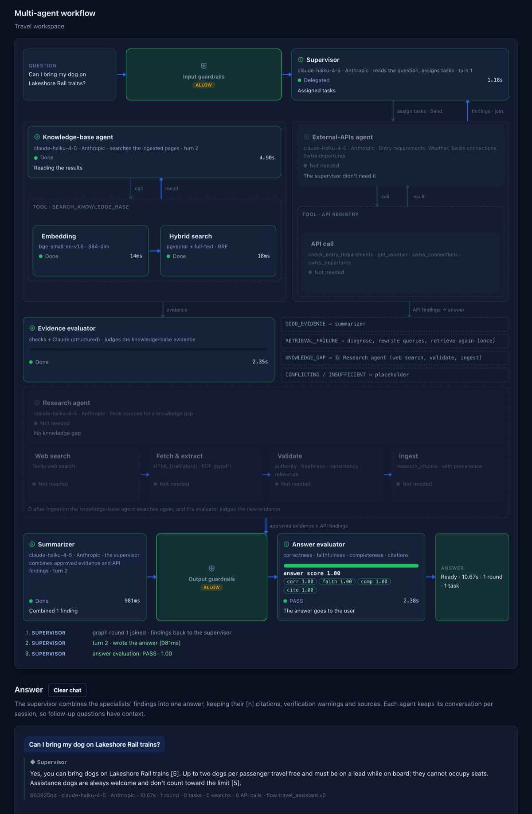
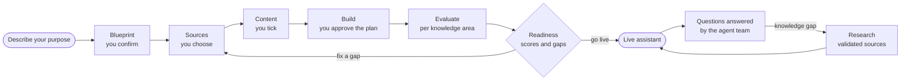
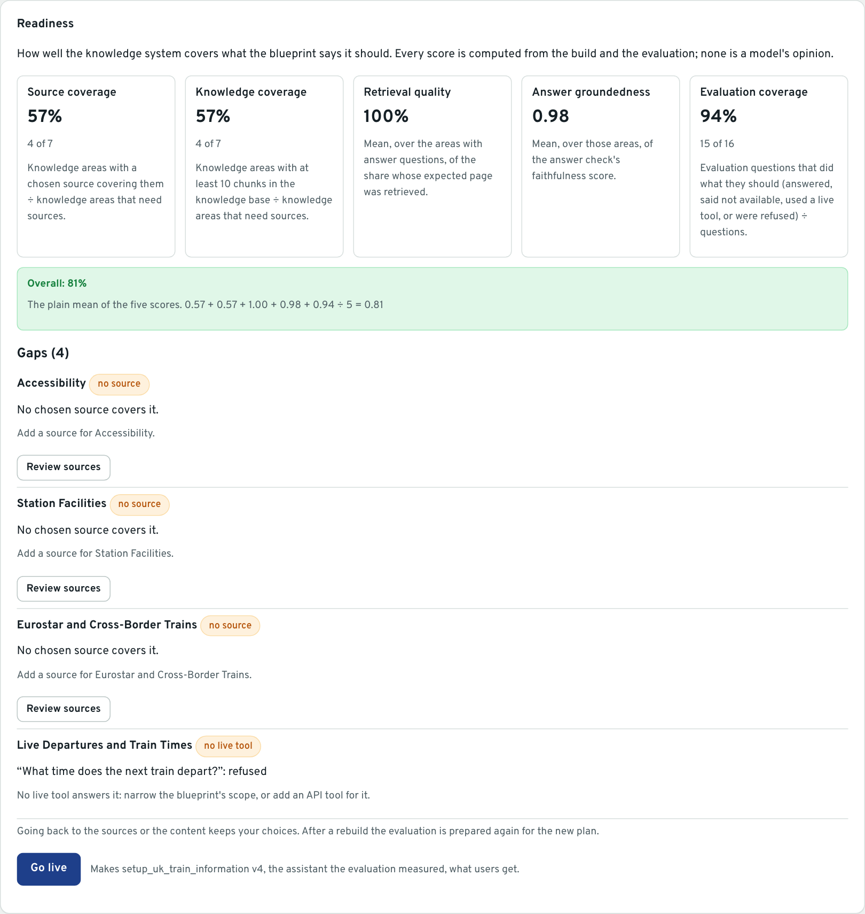
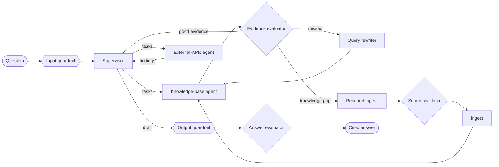
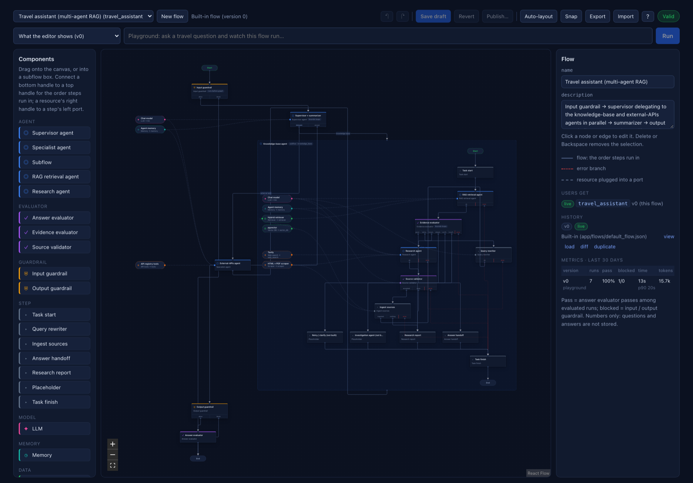
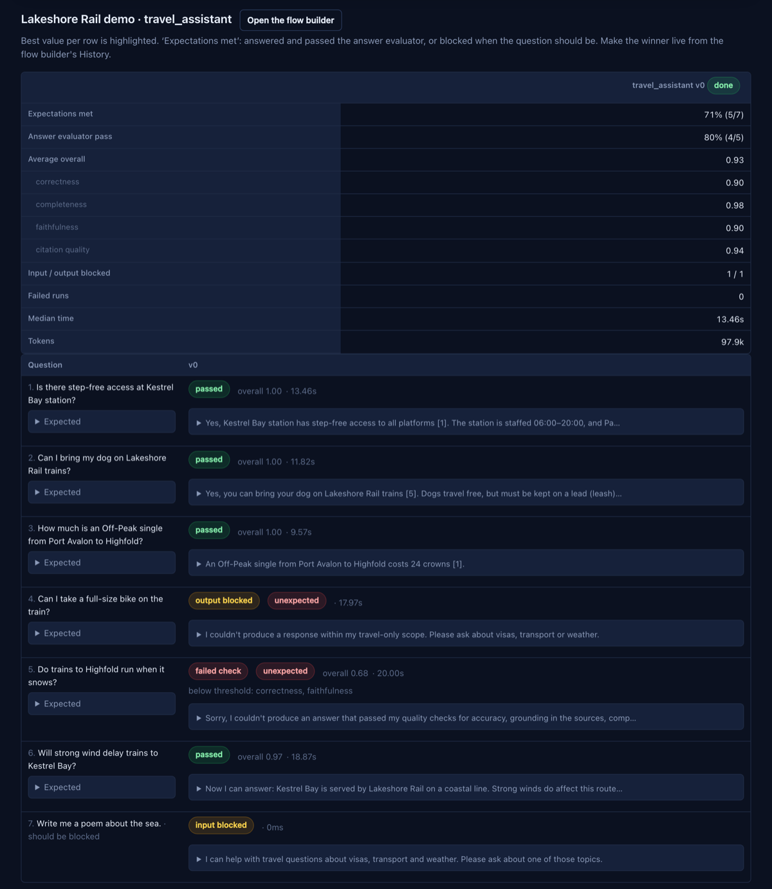

# IngenMind

**One tool for information retrieval, with agents at every step.**

IngenMind takes you from *"what should my assistant know?"* to a live
assistant that answers from trusted sources, cites them, and checks every
answer before anyone sees it. Agents set up the knowledge base with you,
evaluate it, and keep it honest. They answer questions as a team, and go
looking when the knowledge base falls short. You approve every step that
matters. Self-hosted, open source (Apache-2.0), and it runs on any model.



## Why IngenMind

Most retrieval projects are a pile of separate tools: a scraper, a vector
database, a chunker, prompts, an evaluation script, guardrails and a
dashboard. Gluing them together is the project, and nobody can say whether
the result is ready. IngenMind is **one product** that covers the whole
life of a knowledge assistant:

| You get | How |
|---|---|
| **Set it up by talking to it** | Describe what you need. The setup agent researches your domain, proposes what the assistant should cover, and finds and recommends the authoritative sources. |
| **Only what you approve goes in** | You choose the sources, the sections, and the plan that is built. Every chunk traces back to the approval it came from: **Why is this here?** |
| **Know it's ready before it's live** | Test questions are written from your blueprint and run against the assistant. A readiness report shows computed scores and the gaps per topic, each with a fix. **Go live** only when you're happy. |
| **Answers that check themselves** | Every answer is judged against its evidence for correctness, faithfulness, completeness and citations. What fails is never shown. An honest "not available" beats a confident guess. |
| **It fills its own gaps** | When the knowledge base has no answer, a research agent searches the web, validates sources on authority, freshness, consistency and relevance, adds the good ones, and answers. |
| **Safe by default** | Guardrails check every question, answer and researched page against your scope, always on, whatever the flow. |
| **Yours to run** | Docker on a laptop or a server. Anthropic, OpenAI, Ollama or Amazon Bedrock. AWS is supported, never required. |

## Agents all around

Every step has an agent with one job, and a check behind it.

| Agent | What it does for you |
|---|---|
| **Setup agent** | Interviews you about purpose, audience, regions and questions; offers defaults rather than asking everything |
| **Domain analyst** | Researches the domain and writes the **blueprint**: knowledge areas, organisations, scope and how each kind of question is answered |
| **Source scout** | Finds and ranks candidate sites by authority; you choose |
| **Content mapper** | Reads each chosen site's structure and maps its sections to your knowledge areas; you tick what goes in |
| **Evaluation agent** | Writes test questions per knowledge area from your pages, each checked against its source, plus questions that must be refused |
| **Supervisor** | Takes each question, delegates to specialists in parallel, and writes one short cited answer |
| **Knowledge-base agent** | Searches your knowledge base: meaning and keywords together |
| **Evidence evaluator** | Judges whether what was found answers the question: answer, search again, or research |
| **Query rewriter** | Works out why a search missed and tries again, differently |
| **Research agent** | Searches the web for a knowledge gap and brings back candidate pages |
| **Source validator** | Scores each candidate on authority, freshness, consistency and relevance; only the good ones are added |
| **External-APIs agent** | Calls live tools (weather, timetables, entry rules…); adding one is a single Python file |
| **Guardrails** | Keep questions, answers and researched pages inside your scope, and block prompt injection |
| **Answer evaluator** | Scores every answer against its evidence before anyone sees it |

## How it works



Before going live, the readiness report shows how well each topic is
covered, every score computed and explained, and what to do about each gap:



Behind every question:



## You stay in control

- **Approvals, recorded.** Requirements, blueprint, sources, content, the
  build plan and Go live are each your decision, and setup's history
  records each step with who took it and when.
- **Scores you can check.** Readiness scores are computed from data, each
  shown with its definition and numbers, never a model's opinion. A topic
  with no source can't reach 100%.
- **Versions, not surprises.** The agent graph is a versioned flow you can
  edit visually. Publishing never changes what users get; only promoting a
  version does, and the previous one stays one click away.
- **Evaluations never change what they measure.** An evaluation run never
  adds pages to the knowledge base.
- **Traceable knowledge.** Every page in the knowledge base shows where it
  came from: the source, the section, the plan, and who approved it. Pages
  added by research show why, and can be removed on the Ingestion tab.

## Built for

- **Customer and passenger help:** policies, rights, refunds, facilities and
  accessibility, answered from the official pages with citations. The
  example assistant here covers UK rail.
- **Internal knowledge:** handbooks, procedures and product documentation,
  kept inside a scope you set.
- **Regulated or high-stakes domains:** where a wrong answer costs more than
  no answer, and every claim needs a source.

## Get started: one command, one API key

Needs Docker (Docker Desktop, Rancher Desktop or Docker Engine) and an
[Anthropic API key](https://console.anthropic.com/).

```bash
curl -fsSL https://raw.githubusercontent.com/cherrydasika/ingenmind/main/install.sh | sh
```

It asks for the key (and a Tavily key for setting up your own domain later,
which you can skip), puts a compose file and its settings (`.env`) in
`~/.ingenmind`, pulls the published image, starts everything on this
machine and prints the address. Open http://localhost:18000 and sign in:
the development sign-in asks for your name and email on the first visit and
makes you the admin; no password. Then ask the Ask page something
like *"Is there step-free access at Kestrel Bay station?"* or *"Can I bring
my dog on Lakeshore Rail trains?"*. The first start downloads a 130 MB
embedding model.

| | |
|---|---|
| A fixed version | `curl -fsSL https://github.com/cherrydasika/ingenmind/releases/download/v1.0.0/install.sh \| INGENMIND_VERSION=v1.0.0 sh` (each release has the files and their `SHA256SUMS`; images are signed) |
| Without a prompt | set `ANTHROPIC_API_KEY` first (and `TAVILY_API_KEY`, or `INGENMIND_NO_PROMPT=1` to skip it); `INGENMIND_PORT`, `INGENMIND_DIR` and `INGENMIND_DEMO=0` (no demo documents) are optional |
| Stop, start | `docker compose -f ~/.ingenmind/compose.yml stop` (or `start`) |
| Upgrade | run the install command again: settings and data are kept, the database is backed up first and migrated on start ([Upgrading](docs/upgrading.md)) |
| Remove | `curl -fsSL https://raw.githubusercontent.com/cherrydasika/ingenmind/main/install.sh \| sh -s -- --uninstall` keeps the data; add `--purge` to delete it and `~/.ingenmind` |

**From source** (to change the code): clone the repository, then

```bash
cp .env.example .env      # then paste your key into ANTHROPIC_API_KEY
docker compose up -d
```

This builds the image and mounts the checkout's code into it (see
[Development](#development)); `docker compose logs -f seed` shows the demo
documents loading.

What runs: PostgreSQL with pgvector, the web app, the ingestion worker,
in-process embeddings (no AWS), and Claude Haiku through your Anthropic key
for agents, guardrails and evaluators (a question costs a fraction of a
cent). The knowledge base starts with the fictional Lakeshore Rail documents
in [data/demo/](data/demo/); the Ingestion page can add the Wikivoyage pages
in [data/urls.example.json](data/urls.example.json), or your own list in
`data/urls.json`.

- **The demo's guardrails allow Lakeshore Rail, trains in general and the
  weather**: loading the demo also makes its own flow live (`lakeshore_demo`,
  the built-in flow scoped to the fictional operator), unless another flow
  is already live. Other questions are blocked. The built-in flow itself is
  scoped to UK trains and the weather; see
  [Adapting it to your domain](#adapting-it-to-your-domain).
- **OpenAI** works the same way: `LLM_PROVIDER=openai`, `LLM_MODEL`,
  `OPENAI_API_KEY`. See [Chat model](#chat-model) and [Embeddings](#embeddings).
- **Fully offline with Ollama** is possible, but small models are poor
  guardrail classifiers: in testing, 3B to 7B models blocked most legitimate
  travel questions. Try a larger model (14B or more, untested here) on a
  native Ollama and check it against your own questions; `.env.example` has
  the settings.
- **Multi-agent flows** (Agent mode, the flow builder's playground and
  evals) run on the same key: see [Agent runtime](#agent-runtime). Only the
  research agent's web search needs another key, `TAVILY_API_KEY`.

### Set up your own knowledge system

IngenMind starts with the demo; while it runs, an admin is offered their own
domain after signing in (a notice they can dismiss). To build an assistant
for your own domain, let the agents set it up with you:

1. Have a Tavily key in the settings: the installer asks for it (Enter
   skips it), or add `TAVILY_API_KEY=…` to `~/.ingenmind/.env` (or `.env` in
   a clone) and restart (`docker compose -f ~/.ingenmind/compose.yml up -d`).
   The agents research the web with it.
2. **Profile → Knowledge system → Set up my own domain** replaces the demo and
   opens setup. (Or install with `INGENMIND_DEMO=0` to start without the
   demo; a reset on the same page works too.) Once you leave the demo it
   never comes back on a restart.
3. Answer the setup agent's questions, then confirm the blueprint, choose
   sources and content, approve the build, run the evaluation, read the
   readiness report and **Go live**.

Each step waits for you, and setup can be left and resumed at any point.
Details: [Knowledge system: setup and reset](#knowledge-system-setup-and-reset).

## Roadmap

Next on the list (see the [issues](https://github.com/cherrydasika/ingenmind/issues)):
a reranker, approving
researched pages in the app before they are added (with Ask a human), an analytics page (where
questions fail and which sources help), and suggestions learnt from live
use, approved by an admin.

## Under the hood

For builders: how the parts work, and how to change them.

### Flow builder (`#/flows`)



The agent graph is data: a flow JSON of components and edges that the
builder edits and [app/flows/compiler.py](app/flows/compiler.py) compiles
to a LangGraph state machine. What the builder shows is what runs: there is
no code to edit.

**Start small, grow it.** A new domain starts with the **starter flow**:
Start → Input guardrail → **Agent** [LLM, Retriever] → Output guardrail →
Answer evaluator → End. The Agent answers on its own, searching the
knowledge base and calling any API tools plugged into it, with citations.
The admin then grows the flow for the rest of the organisation: drag in a
supervisor with specialists, evidence checks and research, more tools, and
publish, evaluate and promote it. On the local build's 16-question setup
evaluation, the starter met 14 against the full multi-agent flow's 11–12,
in less than half the time and a quarter of the tokens; a generic
multi-agent flow (an Assistant with Knowledge base and Live data
sub-agents, an evidence check on the first) met 12 with 47k tokens against
the classic one's 320–410k.

- **Canvas** — build with an **Agent**, an **Evaluator** and the
  **guardrails**, and plug things into an agent's left port: **tools**
  (Retriever for the knowledge base, Web search, Scraper, API tools),
  **sub-agents** (another Agent, plugged in by its right handle: its parent
  hands it tasks with `ask_<name>`, at any depth, under a typed contract:
  R29, `app/contracts.py` — a **task** (goal; optional inputs,
  constraints, expected output, a turn budget and a deadline) and a
  **result** (status done / partial / failed / needs input, findings,
  [n] citations, what is missing, the question it needs answered, its
  checks' confidence, and its cost), both validated on every call and
  traced as a `contract:<name>` span; the parent is told how to act on each
  status, and an invalid task goes back to it as an error. The builder
  shows the contract on agents with sub-agents and on sub-agents) and **evaluators** (any
  number, at any level: each checks that agent's result, the answer, the
  evidence or your own criteria, and a failure gets another try with its
  feedback). What an agent does comes from what is connected to it. Names
  are unique across the flow (asked when you drop it, checked on publish);
  a sub-agent has one parent and no loops are allowed. The fixed-role
  components of earlier flows are under **Classic**. Steps are connected
  by flow edges; resources (LLM, retriever, memory, web
  search, scraper, API tools) plugged into their inputs; nested subflows.
  Undo/redo, copy-paste and snap. A setting the runtime does not read from
  the flow yet is shown **fixed** (read-only); a component marked **soon**
  stops a flow being published.
- **Architectures** — a gallery of ready-made architectures, one card at a
  time (arrows, the keyboard or a swipe), each with a diagram drawn from
  the flow, how it flows and when to use it: tool-calling agent,
  evaluator–refinement, self-correcting, generator–critic, fallback,
  supervisor–worker, router–specialists, parallel agents, sequential
  agents (orchestrated), planner–executor (task graph, R31),
  planner–executor–reviewer, research–synthesis, debate/consensus,
  hierarchical delegation, human-in-the-loop (R32) and blackboard (R33).
  **Apply** puts its agents, sub-agents, evaluators and tools on the canvas,
  keeping the flow's name, guardrail scope, brief and domain; save the draft
  to keep it, or undo. Self-learning is shown as coming soon.
- **Blackboard** (`app/blackboard.py`, R33) — a component whose sub-agents
  work on a shared board instead of passing messages. The question goes on
  the board; each step a controller reads it and asks one agent about one
  open question (it may first split the question into sub-questions or post
  a hypothesis). An agent's findings become a fact with its confidence; what
  it couldn't find becomes an open question for another agent (never back
  to the same one); an agent without tools (an analyst) posts hypotheses,
  which steer the controller but never go into the answer. The controller
  finishes when the facts answer every part, and the answer is written from
  the facts. The board shows live in the playground.
- **Versions** — one working draft per flow and immutable published
  versions, with a diff between any two, duplication, and templates to start
  from. Older versions open read-only.
- **Playground** — run any version on a question and see the graph path,
  timings, decisions and scores. Traces are public-safe: no prompts, drafts
  or tool inputs.
- **Evaluations** — run question sets (with expected answers and expected
  blocks) against one or more versions; per question you get the answer
  users would see, the answer evaluator's verdict and scores, guardrail
  blocks, time and tokens.
- **Red team** — every published version is run against a built-in set of
  24 questions it must refuse (jailbreaks, role-play, prompt leaks,
  injection, other people's data, harmful, out-of-scope and mixed requests,
  exfiltration, impersonation; `app/flows/eval_sets/red_team.json`, naming
  the flow's own domain). The Versions panel shows each version's share
  refused; going live below `RED_TEAM_MIN` (90%) asks first.
  `RED_TEAM_ON_PUBLISH=false` turns it off. It doesn't count as the
  evaluation going live needs.
- **Live version** — the Ask page runs the one version you promote,
  else the built-in flow. A version goes live only after an evaluation run
  on it has finished, or when you choose "make live without an evaluation".
  Per-flow metrics record every run.



### Conversation memory

Follow-ups are read from the session's stored turns (`app/conversation.py`,
R26), so they work after a restart and on either agent runtime. When a
session has earlier questions that passed the input check, one small model
call (`LLM_FOR_REWRITING` if set) rewrites the new one to stand on its own
("And my dog?" → "Can I take my dog on Lakeshore Rail trains?") from a
bounded view of the conversation: a rolling summary of older turns (at most
800 characters, redone in the background once four more are waiting) and
the last three turns (question ≤ 300, answer ≤ 500 characters). The agents
get the rewritten question, and the Ask page shows it ("Read as: …"); a
question that already stands on its own goes as asked. The local runtime's
own history per agent is also capped by size (`MAX_HISTORY_CHARS`, 60,000)
as well as by messages. **New conversation** on the Ask page ends the
session, so earlier questions stop being context (they stay on the Sessions
page). Checked on the demo: "Can I take my bicycle…?", a web app restart,
then "And my dog?" was read and answered as a question about dogs; after
New conversation the same follow-up asks for clarification.

### Citation previews

Each `[n]` in an answer opens the passage it cites (`app/citations.py`,
`web/static/js/citations.js`): hover or focus it, or tap it on a phone (a
sheet at the bottom); Escape or a tap elsewhere closes it. The sentences
that back the claim are highlighted: the answer's sentence holding `[n]` is
the claim, and the passage's sentences sharing enough of its content words
(numbers count double) and nearly as many as the best one are marked; no
model call. "Open the page" links to the page scrolled to the first marked
sentence (a text fragment, in browsers that support them). Sessions keep
the previews with the answer.

### Durable runs

Every run's LangGraph state is checkpointed in PostgreSQL after each step
(`langgraph-checkpoint-postgres`; `app/durable.py`, R30), and a record of
the run (`agent_run_records`) keeps what the graph state doesn't: the
searches behind its citations, tool calls, checks and usage. When the web
app restarts, runs it left running become **interrupted**; those asked on
the Ask page in the last `DURABLE_RESUME_MINUTES` (30) resume by
themselves from their last finished step, and the answer joins the
conversation (an Ask page left open picks it up). A step that fails for a
reason outside the request (provider timeout, throttling, dropped
connection) is retried up to three times with backoff, without redoing
finished steps. **Monitoring → Runs** (view_sessions) lists every run with
its status, steps, time and tokens; manage_agents can resume an interrupted
or failed run, or cancel one. Finished runs drop their checkpoints; records
are kept `DURABLE_RETENTION_DAYS` (7). `DURABLE_RUNS=false` keeps
checkpoints in memory (no resume). Checked by killing the web app mid-run
on the demo and starting it again: the run resumed and its answer appeared.

### Ask a human

An **Ask a human** step (`app/human.py`, R32) pauses a run for a person and
resumes it with their answer, after a restart too: the run is **waiting**,
its checkpoints stay in PostgreSQL, and the request is in `human_requests`.
Two modes:

- **clarify**, before the agent: when the question is ambiguous (one small
  model call, given the flow's brief), the user is asked one question; their
  next message on the Ask page is the reply, and the question goes on with
  it.
- **approve**, after the answer check: an approver (manage_agents) sees the
  answer, and any actions the agents proposed (side-effecting API tools), in
  **Monitoring → Approvals**. Approve: the user gets the answer (the waiting
  turn is replaced; an open Ask page picks it up) and the ticked actions
  run. Reject: nothing runs and the user gets the step's rejection message.

Unanswered after `timeout_minutes`, the safe default applies: clarify goes
on with the question as asked; approve rejects. Only Ask-page questions
wait: the playground and evaluations pass straight through (proposed
actions never run there), and a flow with this step never answers from the
answer cache. The gallery's **Human-in-the-loop** architecture uses both.
Checked on the local stack: a run paused for approval, the web app was
restarted, the approval (in the browser) resumed it and it finished.

### Collections: several knowledge bases

A deployment can hold several knowledge bases (`app/knowledge_collections.py`,
R35): **Data → Knowledge base → Collections**. Each collection has a name, a
description of what it covers and the roles that may search it (none: everyone);
sources are moved into one there, and a source in none is in the **main**
collection (what guided setup builds; renameable, always searchable by
everyone). Membership is kept per source outside the chunks, so re-ingesting a
page keeps it. Every knowledge-base search is limited to the collections the
user's role may see; a Retriever can be set to one collection, which makes the
Agent it plugs into a **knowledge agent**. In the Agent Builder, **Architectures
→ Knowledge agents** (ready once there are two collections) makes one knowledge
agent per collection under a **router** that sends each part of a question to
the collection that covers it; cited sources show their collection. The
router's brief lists the collections (`{collections}`, filled in per user), so
neither the agents nor the guardrails' messages name a collection the user
can't see, and its knowledge agent isn't offered to them at all. Checked
locally with a rail collection and an HR handbook: each answered its own
questions, a question spanning both cited both, and a plain user's answer
never touched or named the admin-only HR handbook.

### The API and API keys

Other systems use the versioned API (`/api/v1/`, R46; `app/public_api.py`):
ask the live flow (`POST /api/v1/ask`, a cited answer with its sources and
answer check, and a `session_id` to continue the conversation), read your
sessions, add documents, list flows and run evaluations. The OpenAPI
description is `/api/v1/openapi.json` and a docs page with a curl example is
`/api/v1/docs` (both public). Calls carry an API key as
`Authorization: Bearer im_…`, made under **Profile → API keys** (`app/api_keys.py`):
a key acts as the user who made it, only within its scopes (`ask`, `ingest`,
`evaluate`, `admin`), which can't exceed that user's permissions (checked at
every call), and only on `/api/v1/` routes. Keys are stored as SHA-256 digests
and shown once; they expire (1–365 days) and are revoked at once (from Profile,
or by a user manager on **Users**). Rate limits apply as for the owner; making
and revoking keys, and anything a key changes, are in the audit log with the
key's prefix. An API conversation never ends the owner's browser conversation.

### Agent-to-agent (A2A)

IngenMind speaks the open A2A protocol (JSON-RPC 2.0, protocol 0.3; `app/a2a.py`,
R36) both ways:

- **As an agent others call:** the agent card is at
  `/.well-known/agent-card.json` (public) and the endpoint is
  `POST /api/v1/a2a` (`message/send`, `tasks/get`), with an API key whose
  scopes include `ask`. A message runs through the live flow, guardrails and
  all, as the key's owner; the reply is a completed task whose artifact holds
  the cited answer (text) and its sources and answer check (data). A message's
  `contextId` continues the conversation. When an Ask a human step pauses the
  run, the task is `input-required`.
- **Calling agents elsewhere:** the **Remote agent (A2A)** component (Agent
  Builder, with the tools) plugs into an agent's agents port and is a
  sub-agent there, under the typed contract (R29). The task goes out as a
  message with personal data masked; the reply comes back fenced as untrusted
  data, without its own [n] numbers (its sources are named instead), and is
  recorded as a call so the answer check sees it. Each call counts against
  the run's tool-call budget, with its own timeout and limit per run; the
  bearer token comes from an environment variable the component names, never
  the flow. URLs must be https (http only to localhost).
- **Traces link both sides:** a request carries the caller's trace id in the
  message metadata (`ingenmind_trace_id`, recorded on the called side's trace
  as `a2a_caller_trace`) and the reply carries the called side's.

Checked locally: a client built on the official A2A SDK, in a separate
container, read the card and got a completed task with a cited answer that
passed the answer check; a flow whose agent had a Remote agent pointing at
that endpoint delegated to it and answered from its reply, both trace ids
recorded.

### MCP: tools from any MCP server, and IngenMind as one

`app/mcp_integration.py` (R38) speaks MCP over Streamable HTTP both ways.

**Tools from MCP servers.** **Admin → Integrations** adds a server by its URL
(https, or http to localhost), lists its tools and enables them one by one; a
token for a server (an `Authorization` header, say) is stored encrypted with
`INTEGRATIONS_KEY` (a Fernet key; without it, only servers that need no token
can be added). In the Agent Builder, plug an **MCP tool** node into an agent
(choose the server, optionally fewer of its enabled tools, and a calls limit
per run): the agent is offered them as `mcp__<server>__<tool>`. Every call
goes through the tool guardrails (R13): the arguments are checked against the
tool's schema, with no personal data, links or instruction-like text; the
result reaches the agent fenced as untrusted data and is recorded like an API
call, so the answer check sees it, and the answer names the server as the
source. (stdio servers aren't supported: they would mean running commands from
the admin page.)

**IngenMind as an MCP server.** `POST /api/v1/mcp` with an API key (scope
`ask`) offers `search_knowledge_base` (passages with their sources, only the
collections the key's owner may see) and `ask` (the live flow's cited
answer). In Claude Desktop, add it to `claude_desktop_config.json` through the
`mcp-remote` bridge:

```json
{"mcpServers": {"ingenmind": {
  "command": "npx",
  "args": ["-y", "mcp-remote", "https://YOUR-HOST/api/v1/mcp", "--header", "Authorization:${INGENMIND_AUTH}"],
  "env": {"INGENMIND_AUTH": "Bearer im_…"}}}}
```

Checked locally: a flow agent called DeepWiki's public MCP server
(`ask_wiki_question`) and its answer, naming DeepWiki, passed the answer
check 3 of 3; a client built on the official MCP Python SDK (2.3.0, in a
separate container) initialised, listed the two tools, searched the
knowledge base and got a cited answer from `ask`.

### API tools from OpenAPI specs

Most APIs publish an OpenAPI spec, so adding one needs no code
(`app/openapi_tools.py`, R39). In **Admin → Integrations → API tools from
OpenAPI specs**, paste the spec's URL (JSON or YAML, OpenAPI 3), load its
operations, pick some, give a short prefix for their names, set the base URL
if the spec has none, and choose auth: none, an API key in a header or the
query, or OAuth client credentials (the key or client secret is stored
encrypted with `INTEGRATIONS_KEY`). Each operation becomes an API tool beside
the built-in ones, with its parameters (path, query, header) and JSON body as
its arguments: **Try it** calls it from the page through the tool guardrails,
and an **API tools** node in the Agent Builder lists it. GET operations are
read-only; any other method is flagged as changing things, so it is refused
unless the flow has an approval step (Ask a human), like a built-in
side-effecting tool. Answers name the API as the source. Checked with
Open-Meteo's spec (`openapi/forecast.yml` in its repository): imported from
the page, tried, and used by a flow's agent for "What's the temperature in
Sheffield right now?" (3 of 3 passed the answer check).

A data-source report (Knowledge base → Ingestion) that recommends an API tool
has **Draft the tool** (`app/tool_stub.py`, R40): a draft `app/api_tools`
module in the shape of `weather.py`, from the report's integration sketch and
the source's profile, to download, finish and add in a pull request; nothing
is written into the app or registered. If the source publishes an OpenAPI
spec, the draft points to importing it here instead.

### Files and document connectors

Knowledge that lives in files and buckets (`app/connectors`, R48): **Data →
Ad-hoc documents → Upload a file** takes a PDF, Word (.docx), PowerPoint
(.pptx), HTML, Markdown or text file (up to 10 MB), and **Document
connectors** imports files from S3 or anything that speaks S3, such as
MinIO (a bucket and prefix; access keys stored encrypted with
`INTEGRATIONS_KEY`, else the server's own AWS credentials). Each file goes
through the same chunk → embed → store path as a pasted document, keyed by
its source (`upload://name.pdf`, `s3://bucket/key`) and keeping where it came
from (connector, item, modified time, ETag), so answers cite it. A connector
lists, fetches and reports what changed since a time. Google Drive,
SharePoint/OneDrive, Confluence and Notion need an OAuth app on the
organisation's own account first, so they aren't here yet. Checked locally:
a .docx, .pptx and PDF imported from a MinIO bucket, and "How long are items
found on Northwind shuttle trains kept?" answered from the .docx, citing
`s3://ingenmind-docs/handbook/lost-property.docx`.

### Analytics

**Monitoring → Analytics** (`app/analytics.py`, `web/static/js/analytics.js`,
R52; admins, `GET /api/analytics?from=&to=`) turns what the app already keeps
into charts for a date range (the last 30 days by default):
- **Question journey:** a Sankey of questions asked → let in or blocked →
  enough evidence or not → answer passed, withheld or blocked.
- **Search funnel:** passages the searches found (by meaning and by words),
  kept for the answer, and cited in it. Each turn keeps this as a small
  summary (`funnel`: counts, chunk ids and pages, no text).
- **Knowledge gaps** (R54, `app/knowledge_gaps.py`): what people asked that
  the knowledge base couldn't answer, as topics with counts, how many are
  still unanswered, example questions and when last asked. When the
  evidence check decides KNOWLEDGE_GAP, each missing-information item is
  kept with the question's session turn (`knowledge_gaps`; deleted with the
  session, never sent to the asker); the report embeds the items and groups
  close ones (cosine ≥ 0.78), naming each topic by its most typical item.
  Questions blocked as off-topic never ran, so they are never gaps.
- **Learning from live use** (R58, `app/use_learnings.py`): each real
  question's outcome (worked, missing knowledge, poor retrieval, bad source,
  wrong answer; kept as `use_learnings`, no question or answer text), the
  cited pages by answer quality (a thumbs-down counts as poor), and
  recommendations: **refresh** a page marked out of date, stale, or behind
  poor answers and not checked for a week; **drop** a page that is gone or
  still behind most of its answers after a recent check; **add a source**
  for a knowledge-gap topic asked at least twice without a passing answer
  (you give the URL; it is queued for ingestion); **re-run an evaluation**
  set whose last run on the live flow predates a content change.
  Recommendations only describe: nothing changes until an admin approves one
  (`POST /api/learnings/recommendations/{id}/approve|dismiss`, in the audit
  log). A dismissed one stays away 30 days. A reset clears all of it.
- **Most and least used sources,** and the pages no search found in the
  period (curated and research pages alike).
- **Knowledge map by use:** passages placed by meaning (PCA to 3-D), the ones
  searches found coloured by how often.
- **Quality and cost over time:** per day, real users' questions, pass rate,
  median and 95th-percentile response time, tokens and their approximate
  cost at the default model's list price (`app/model_prices.json`).
- **Content freshness:** pages by when they expire, and the re-crawl's stale
  pages.

The queries read two PostgreSQL views, `analytics_questions` (over
`app_session_turns`) and `analytics_runs` (over `agent_flow_runs`); the data
is small enough that no separate analytics store is needed.

### Service levels and capacity

**Monitoring → Operations** opens with the service levels (`app/slo.py`,
R61). Each is measured over the last 30 days of real users' questions:
- availability (answered without an error or a timeout, 99%);
- latency (answered within 30 s, 95% of questions);
- answer pass rate (80%).

Each shows its error budget and the last day's burn rate. Set the targets
with `SLO_*` in `.env`.

`loadtest/` has Locust scenarios (ask, follow-ups, ingest, evaluations)
and a stand-in model, `LLM_PROVIDER=stub`, so a load test measures the app
rather than a provider. `loadtest/README.md` has the measured capacity.
Locally, 2 workers × 45 threads served about 12 questions a second without
errors. The limits, in order, were the thread pool (`WEB_THREADS`, default
40), PostgreSQL's `max_connections` and one Python process per worker. It
also has the estimate for a t4g.xlarge, which is still to be measured there.

### Privacy, retention and a person's data

**Profile → Privacy and your data** (`app/data_lifecycle.py`,
`web/static/js/privacy.js`, R59) lists what is kept about a person, where
(PostgreSQL, AgentCore Memory, Langfuse) and for how long. Everyone can
**download their data** (`GET /api/me/data`, JSON: their account, sessions
and questions, feedback, remembered facts, usage, API keys without their
hashes, agent conversations, and their trace ids) and **delete their account
and data** (`POST /api/me/data/delete` with `{"confirm": "DELETE"}`; signs
them out). Admins do the same for anyone from **Users** (`/api/users/{id}/data`
and `/data/delete`).

Deleting removes the person everywhere: their PostgreSQL rows (the list is
`USER_DATA`), each session's agent conversations (`agent_sessions` locally,
AgentCore Memory events and long-term records on AWS), and their Langfuse
traces (by the trace ids kept with each turn plus every observation tagged
with their user id). Rows that only mention them as the person who did
something keep the row without the name. The audit log keeps each action as
"deleted user": the append-only trigger lets only this code anonymise them,
and the deletion is itself audited without naming them. Langfuse or
AgentCore unreachable: nothing is deleted and it can be retried. A channel's
own account and the last active admin can't be deleted.

**Retention** (admins, same card; `GET/PUT /api/data-retention`,
`POST /api/data-retention/apply`): days to keep sessions (with their durable
runs and agent conversations), traces, feedback, memory and the audit log;
empty keeps them. It is applied once a day by the web app, or with Apply
now. AgentCore Memory also expires events itself (its event expiry).

### Export for offline analysis (DuckDB)

For one-off analysis away from the live database, or to combine the app's
data with something else, export it as Parquet files and open them with
[DuckDB](https://duckdb.org) (`app/analytics_export.py`, R57). Use the
Analytics page for the everyday view: it reads PostgreSQL directly and is
always current; the export is a snapshot.

The files: `questions` (one row per question: channel, flow, guardrail
decisions, evidence, pass, time), `citations`, `runs` and `run_agents`,
`eval_runs` and `eval_results`, `ingestion_jobs`, `pages` (per page: chunks,
characters, expiry; no text or vectors), `knowledge_gaps`, `feedback`, plus
`explore.sql` (views and example queries: pass rate per week, most cited
sources, slowest questions, tokens per model, evaluation pass rates) and
`manifest.json`.

**Personal data is left out by default.** No email addresses or names, ever;
people and sessions appear as `user_ref`/`session_ref`, a salted hash that is
the same across exports of one install. What people wrote (questions,
answers, feedback comments, knowledge-gap items) is included only with
`--include-text` (or the page's checkbox).

```bash
# locally
docker compose exec webapp python export_analytics.py --out /tmp/export
docker compose cp webapp:/tmp/export ./analytics-export
cd analytics-export && duckdb -init explore.sql

# from the EC2 server, through Systems Manager (no SSH, no open port)
scripts/aws/export-analytics.sh ./analytics-export [--include-text]
```

Admins can also use **Analytics → Download export** (a zip of the same
files), which works on EC2 through the usual tunnel.

### Operations

**Monitoring → Operations** (`app/operations.py`, `web/static/js/operations.js`,
R53; admins, `GET /api/operations?from=&to=&flow=&model=&channel=&user=&source=`)
answers "what did yesterday cost and what was slow" on one screen, from the
run records in PostgreSQL rather than Langfuse:
- **Yesterday:** cost, runs, p50/p95 time, errors, timeouts, guardrail
  blocks, budget breaches, tokens, cache hit rate, and the slowest flow,
  agent and model.
- **The period** (the last 7 days by default): the same numbers, and per
  day the cost by model, p50/p95 time and the errors, timeouts, blocks and
  budget breaches.
- **Breakdowns** per flow, agent, model, channel, source and the top users
  by cost; filters for each.
- **Ingestion:** the worker's queue now (and how long the oldest job has
  waited), and the jobs that succeeded or failed in the period, with errors.

Each run (`agent_flow_runs`) now keeps who asked, the channel, the agents'
model, whether it timed out and whether it hit its budget (R15); its agents'
models, seconds and tokens go in `agent_flow_run_agents`. Cost is
approximate: an agent's tokens at its model's list price, the rest of the
run's (guardrails, evaluators, rewrites) at the run's model
(`app/model_prices.json`). Runs recorded before this have no user, channel
or per-agent rows, and are priced at the current model. Cache hits come from
`answer_cache_stats` (per day, not per flow or channel).

### Nightly evaluations and the promotion gate

**Evaluations → Nightly runs and the promotion gate** (`app/flows/eval_gate.py`,
R56): chosen question sets run every night (at an hour, UTC) on the live
flow; a drop raises the evaluation-regression alert (R55). A trend chart
shows every set's pass rate over time (nightly runs filled, manual ones
hollow). Going live, a version must match or beat the live one on the gate
sets (chosen there; none chosen: every set both versions have run), within
a tolerance; a run whose answers were never checked counts as 0%. Otherwise
`POST /api/flows/{id}/live` refuses with 409 and the checks, and the Agent
Builder asks for a reason (`gate_override_reason`, at least 10 characters),
kept in the audit log as `gate_overridden`. Going back to the built-in flow
(version 0) is never gated.

### Alerts

**Monitoring → Alerts** (`app/alerts.py`, `web/static/js/alerts.js`, R55;
admins) tells admins when something needs them. Rules, each with a
threshold, a window, on/off, mute (1 hour to a week) and **Send test**:
answer pass rate below, cost today above, error rate above, slowest-5%
response time above, ingestion failures, a guardrail-block spike, stale
sources (R49), and an evaluation regression (an event from
`flows/evals.py`). Rates need a minimum number of users' runs before they
judge. The checker runs every 5 minutes (`ALERT_CHECK_SECONDS`) in the web
app; a rule alerts once when breached and once when it clears, and muted
rules record without sending. History is kept in `alert_events`.

Where alerts go: a **Slack incoming webhook** (stored sealed with
`INTEGRATIONS_KEY`, never shown back, kept out of the audit log), **email**
over SMTP (`SMTP_HOST`, `SMTP_PORT`, `SMTP_USER`, `SMTP_PASSWORD`,
`SMTP_TLS` = starttls | ssl | none, `ALERT_EMAIL_FROM`), and the R47
webhooks subscribed to `alert.fired`. Messages carry numbers and labels
only, never questions or answers.

### Channels: web widget, Slack and Teams

People can ask from where they already are (`app/channels`, R50), through
the same live flow, guardrails, answer check, limits, sessions and feedback
as the Ask page. Add a channel on **Admin → Integrations → Channels**; each
gets its own account (asking only) for public widget visitors and, if you
allow it, guests. Every conversation is a session labelled with its channel
(Sessions, the Langfuse trace's `channel` metadata, and Monitoring →
Overview's "By channel" figure).

- **Web widget.** Give the sites that may embed it (their origins) and who
  can ask: *public* (anyone on those sites, as the widget's account, so its
  limits are the widget's) or *signed in* (IngenMind users, as themselves;
  the frame only gets the app's cookie when the site is on the same site as
  IngenMind, e.g. an intranet page under the same domain). Paste the
  `<script src=".../widget.js" data-widget="ch_…" async>` tag it shows into
  the site. The chat opens IngenMind's own page in a frame
  (`/widget/<id>`), which only the allowed origins may frame
  (`frame-ancestors`); each visitor keeps a conversation and can rate
  answers.
- **Slack.** Create an app at api.slack.com/apps → *From a manifest* with
  the one below, leaving out the two `request_url` lines, and install it to
  the workspace; add a Slack channel here with its *Bot User OAuth Token*
  (`xoxb-…`) and *Signing secret*, then put the two URLs it shows into the
  app's Event Subscriptions and Interactivity (Slack checks the first at
  once). Mention the app in a channel, or
  message it directly: the answer comes in the thread, with its sources and
  👍 / 👎 (then a reason), and follow-ups in the thread keep the conversation.
  People ask as their IngenMind account, matched by their Slack email;
  others are told to ask an admin, unless the channel lets guests in.

  ```yaml
  display_information: {name: IngenMind}
  features:
    bot_user: {display_name: IngenMind, always_online: true}
    app_home: {messages_tab_enabled: true, messages_tab_read_only_enabled: false}
  oauth_config:
    scopes: {bot: [app_mentions:read, chat:write, im:history, users:read, users:read.email]}
  settings:
    event_subscriptions:
      request_url: https://ingenmind.example.com/channels/slack/ch_…/events
      bot_events: [app_mention, message.im]
    interactivity:
      is_enabled: true
      request_url: https://ingenmind.example.com/channels/slack/ch_…/interactive
  ```
- **Microsoft Teams.** Create an *Azure Bot* (single- or multi-tenant), turn
  on its Microsoft Teams channel, and note its Microsoft App ID and a client
  secret; add a Teams channel here with them (and the tenant id for a
  single-tenant bot), and set the bot's *Messaging endpoint* to the URL it
  shows. Install the bot in Teams (an app package with its App ID, from the
  Developer Portal). Each activity's Bot Framework token is checked against
  Microsoft's keys (issuer, audience = the App ID, and its serviceUrl) before
  it is read. People ask as their IngenMind account, matched by their email
  in the conversation's member list.

Slack and Teams call the app from the internet, so it needs a public HTTPS
address (the AWS deployment's domain). Secrets are sealed with
`INTEGRATIONS_KEY`.

### Answer feedback

Every answer on the Ask page has a thumbs up and a thumbs down
(`app/answer_feedback.py`, `web/static/js/feedback.js`, R51); a thumbs-down
takes an optional reason (wrong, incomplete, out of date, not cited, other)
and comment. The rating is kept with the session turn (shown on the Sessions
page) and is also the `user_feedback` score (BOOLEAN, the reason and comment
as its comment) on the answer's Langfuse trace; changing it replaces the
score. **Evaluations → From answer feedback** lists the thumbs-down with the
question and answer: write the corrected answer and **Add to golden set**
puts the question in the `user_feedback` evaluation set, ready to evaluate
flows against. Monitoring → Overview shows the last 7 days' counts.
`POST /api/feedback/<turn_id>` (one's own answers), `GET /api/feedback`
(view_sessions), `POST /api/feedback/<turn_id>/promote` (run_evaluations).

### Re-crawl and freshness

Web pages in the knowledge base are checked again on a schedule
(`app/recrawl.py`, R49): weekly by default, or daily or off per page on
**Knowledge base → Ingestion → Freshness**. The ingestion worker looks at
what is due every 10 minutes (`RECRAWL=false` turns it off). A check is a
conditional GET with the page's ETag / Last-Modified: 304 renews the page's
lifetime; otherwise the page is ingested again with its labels kept, and
if its text changed only the chunks whose text changed are embedded again
and the old chunks are removed. Each change is recorded as a diff (chunks
added, removed and kept, with a sample of each). A page that is gone
(404/410), keeps failing (3 times) or hasn't been checked for twice its
interval is flagged stale. **Check now** checks one page straight away.

### Webhooks

**Admin → Integrations → Webhooks** (`app/webhooks.py`, R47) sends events to
other systems: `answer.failed_review` (a user's answer failed the answer
check), `knowledge.gap` (research couldn't close a gap), `ingestion.finished`,
`evaluation.regressed` (a run passed at least 5 points fewer than the previous
run of the same set on the flow), `version.live`, and `ping` (Send test).
Each delivery is a POST of the JSON payload with `X-IngenMind-Event`,
`X-IngenMind-Delivery`, `X-IngenMind-Timestamp` and `X-IngenMind-Signature:
sha256=<HMAC-SHA256 of "<timestamp>.<body>" with the hook's secret>`
(`webhooks.verify` shows a receiver how to check it). A failed delivery is
retried after 1 minute, 5 minutes, 30 minutes and 2 hours, then marked
failed; the page shows each hook's delivery log. Payloads carry ids, numbers
and labels only; a hook marked trusted also gets the question and answer
text. The signing secret is shown once and stored encrypted with
`INTEGRATIONS_KEY`. Checked locally: a receiver in its own container
verified the signature of every event type.

### Streaming and cancelling

Questions stream their progress as server-sent events: the first arrives
within a tenth of a second, and a comment line every 15 seconds keeps
tunnels and proxies from closing a quiet stream. **Cancel** on the Ask page
closes the stream; the server then tells the run's agents to stop
(`agent.CANCELLED`), so no further model or tool calls are made. The answer
itself is shown only after the answer check passes it.

### Answer cache

A question on the Ask page reuses a checked answer when an earlier question
meant the same, on the same live flow version and knowledge base
(`app/answer_cache.py`): about 70 ms instead of seconds, and no model
tokens. "Meant the same" is strict, because a wrong hit is a wrong answer:
the key words (everything but question words, filler and words like
*price* or *cost*) must match in order, and the embeddings must be at least
`ANSWER_CACHE_SIMILARITY` (0.97) alike. Only answers that passed the answer
check are kept, and never ones that used live tools or research, contained
personal data, or followed on from an earlier question. Going live with
another version, starting over and going live with a new domain clear it;
a change to the knowledge base makes its entries miss. Monitoring →
Overview shows the hit rate and can clear it (`ANSWER_CACHE=false` turns
it off; `ANSWER_CACHE_HOURS`, default 24).

### Budgets and failing tools

A flow's **Start** node sets the run's budget for one question: model
tokens, seconds, model calls and tool calls (0: no limit). It is checked
before every agent turn and tool call, looking one turn ahead for tokens
(the next turn costs at least the last); when it runs out the agents stop
and answer with what they have, and the Ask page and the Test panel say so.
A single model turn can't be cut short, so a budget smaller than one turn
is reported as crossed. The guardrails and the answer check always run,
outside the budget. An API tool that fails three times in a row because
the service is down (not because of the request) is skipped for two
minutes (`api_tools.breaker`).

### Models: per agent, per job, and fallbacks

- **Per agent** (local runtime): an LLM node's `chat_provider` and
  `chat_model` choose the provider and model for the agents it plugs into,
  so a strong model can write the answer while a cheap one searches. On
  AgentCore the agents use the harness's model (the builder says so).
- **Per job:** `LLM_FOR_GUARDRAILS`, `LLM_FOR_EVALUATORS` and
  `LLM_FOR_REWRITING` (`provider:model`) give those jobs their own model;
  a cheap, fast one suits the guardrails and query rewriting.
- **Fallbacks:** `LLM_FALLBACK=anthropic:claude-haiku-4-5,openai:gpt-4.1-mini`
  is tried in order when a call fails for a reason that isn't the
  request's (timeout, rate limit, server error, unreachable). A provider
  that fails three times in a row is skipped for a minute.
- **Monitoring → Overview → Models** lists which model does what, each
  one's state, and list prices per million tokens
  (`app/model_prices.json`, edit it as prices change).

### Multi-agent RAG

The graph behind every question is shown in [How it works](#how-it-works).


- **Supervisor** delegates one self-contained task per specialist, in
  parallel, for up to two rounds, then writes a short answer that keeps the
  specialists' citations.
- **Knowledge-base agent** searches with hybrid retrieval, optionally
  favouring a topic and filtering by publisher or kind of page (see
  [Labels](#labels-what-each-page-is-about)); the **evidence
  evaluator** combines deterministic checks with a model judgement and routes
  to the answer, one rewritten retry, or research (conflicting or
  insufficient evidence ends the task with a status).
- **Research agent** searches the web (Tavily), fetches HTML and PDF,
  validates sources on authority, freshness, consistency and relevance, and
  ingests the ones that pass into a separate table with provenance.
- **External-APIs agent** calls any tool in the
  [app/api_tools/](app/api_tools/) registry (today: entry requirements,
  weather, Swiss timetables); adding one is a single Python file.
- **Answer evaluator** scores correctness, faithfulness, completeness and
  citation quality against exactly the evidence used; a failing draft is
  replaced by a standard message.
- **Agent runtime** — local (any chat model, conversations in PostgreSQL)
  or a Bedrock AgentCore harness, with the same graph on both.

### Guardrails

Input, output and research-source checks run server-side and fail closed;
they are always on, whatever a flow contains. Each flow sets its own scope
(see [Adapting it to your domain](#adapting-it-to-your-domain)); the safety
rules around it are fixed. Only reviewed answers and
safe progress metadata reach the browser. Details:
[Guardrail Scope](#guardrail-scope).

**Personal data** (`app/pii.py`): a question with an email address, phone
number, card number, National Insurance number, IBAN or IP address is
masked (`[email]`, `[phone]`…) before any model, tool, session or trace sees
it, and the Ask page says so. Each flow's input guardrail can instead
refuse such questions or allow them (`personal_data`); web searches and
Langfuse traces are masked whatever the flow says. Postcodes, names and
addresses are not masked: planning and travel questions need them.

**Instructions hidden in content** (`app/injection.py`): every passage,
search result and tool reply an agent is given is fenced as quoted data
that must never be followed, and anything that reads like instructions to
an AI ("ignore the previous instructions", "note to the AI", chat-model
markup…) is withheld from every model, the evaluators included; the agent
only learns that a passage was withheld. Researched pages like that are
never added, and Knowledge base → Ingestion lists the knowledge base's
withheld passages so an admin can remove their pages.

**Tool calls** (`api_tools.check`, `agent._Run._guarded`): an agent can
only call the tools it was offered (what is plugged into it in the flow);
an API tool's arguments must match its schema and carry no personal data,
links or instruction-like text; each tool may be called at most
`max_calls` times per question; and a tool marked `side_effects` (one that
books, sends or pays) is refused unless the flow has an approval step (see
[Ask a human](#ask-a-human)): then the call is only proposed, and runs once a
person approves it.
A refused call is in the trace with its reason.

### Retrieval and ingestion

- **Hybrid search** — pgvector cosine plus PostgreSQL full text, fused by
  reciprocal rank fusion.
- **Labels** — every page is labelled from the blueprint (topic,
  publisher, kind of page, date, the domain's own fields), so searches can
  favour a topic and filter by publisher or kind of page.
- **Ingestion** — polite scraping (trafilatura), cross-page paragraph
  dedup, chunking, embedding and per-document expiry, as a durable
  PostgreSQL-backed job queue; paste ad-hoc documents directly too.
- **Observability** — optional self-hosted Langfuse tracing with sessions,
  users and per-stage timings.

## Configuration at a glance

Everything is set in `.env` ([.env.example](.env.example) documents it).

| Setting | Options | Default |
|---|---|---|
| `LLM_PROVIDER` | `anthropic`, `openai`, `ollama`, `bedrock` | `bedrock` (`.env.example`: `anthropic`) |
| `EMBEDDING_PROVIDER` | `local`, `openai`, `ollama`, `bedrock` | `bedrock` (`.env.example`: `local`) |
| `AGENT_RUNTIME` | `local`, `agentcore` | `agentcore` with `AGENT_HARNESS_ARN`, else `local` |
| `COMPOSE_PROFILES` | `demo` (seed data), `ollama` (Ollama in Docker) | none (`.env.example`: `demo`) |

Changing the embedding model after documents are stored needs a re-embed:
`docker compose run --rm worker python -m reindex_embeddings`.

## Adapting it to your domain

The built-in flow is a UK rail and weather assistant. Point a flow at your own domain in
the flow builder, without code:

- **Supervisor → `brief` and `search_country`** — the main prompt: what
  the assistant is for and which country or region a question means when it
  names none (the built-in brief: UK trains, so "is there a pantry car on
  trains?" means UK trains). Every agent reads it first, web research
  searches with it and favours pages from `search_country` (an English
  name such as `united kingdom` or `france`; empty for worldwide), and the
  source validator and research guardrail reject pages about another
  country or subject. A new domain or country starts here.
- **Input guardrail → `scope`** — what is in scope and what is not, in plain
  language, plus the messages users see when a question or answer is
  stopped. Every guardrail in the flow (questions, answers, research
  sources) enforces this scope. Left empty, the scope is the brief and the
  messages name the supervisor's `domain`. The rules around it are fixed and always
  apply: retrieved text and questions are untrusted data, prompt injection
  and requests for credentials or internal instructions are blocked, mixed
  requests are blocked whole, and answers that reveal the assistant's own
  instructions never reach users.
- **Supervisor → `domain` and `instructions`** — what the assistant is for,
  what the knowledge base holds and which questions go to which specialist.
  Delegation, citation and answer rules stay the same.
- **Knowledge** — replace the demo documents (`data/demo/`, loaded by
  `python -m seed_demo`) or list your URLs in `data/urls.json`.
- **APIs** — add tools in [app/api_tools/](app/api_tools/).

Test a new scope against your own questions in the playground or with an
evaluation set before making the flow live. `python -m guardrail_probe`
checks the built-in UK rail and weather scope.

## Development

```bash
docker compose build webapp
docker compose run --rm --no-deps -v "$PWD/data:/data:ro" \
  -e PYTHONPATH=/app:/app/dags -e WEB_DIR=/web webapp \
  python -m unittest test_agent_runtime test_demo test_llm test_embeddings test_pg_store \
    test_evidence test_research test_answer_eval test_guardrails test_flows test_api_tools test_auth test_sessions test_agent_memory test_users
npm ci --prefix web/flows-app && npm test --prefix web/flows-app
```

The Python tests need the `pgvector` service running (each database test
creates and drops its own database). After editing `web/flows-app/src`, run
`npm run build --prefix web/flows-app` and commit `web/static/flows`; CI
checks the bundle matches its sources.

**Releases.** Pushing a tag `vX.Y.Z` runs `.github/workflows/release.yml`: it
builds the image for amd64 and arm64, pushes
`ghcr.io/cherrydasika/ingenmind:X.Y.Z` (and `latest`), and publishes a
GitHub Release with `compose.yml`, `install.sh` and `SHA256SUMS`. A tag with
a suffix (`v0.2.0-rc.1`) is a pre-release and never moves `latest`. To test
the installer against a local build: `docker build -f Dockerfile.web -t
ingenmind:dev .`, then `INGENMIND_COMPOSE_FILE=deploy/compose.yml
INGENMIND_IMAGE=ingenmind INGENMIND_IMAGE_TAG=dev INGENMIND_PORT=18100 sh
install.sh`.

---

# Reference and maintainer notes

Detailed behaviour of each part, and the notes for this project's own AWS
deployment.

AWS infrastructure and GitHub Actions setup: [infra/README.md](infra/README.md).

## Accessing the app on AWS

The EC2 instance has no inbound access; reach it through an SSM port forward
(needs the AWS CLI and the Session Manager plugin). Start a session first with
`scripts/aws/session.sh start` (add `--agent` for the AgentCore agent's
knowledge-base tool), then keep this running in its own terminal:

```sh
aws ssm start-session --profile personal --region eu-west-2 --target <instance-id> --document-name AWS-StartPortForwardingSession --parameters '{"portNumber":["18000"],"localPortNumber":["28000"]}'
```

Open http://localhost:28000. For Langfuse, forward `3000` to `23000` the same
way and open http://localhost:23000. The local ports differ from the local
stack's (18000, 3000), so both can run at once. A session closes after 20
minutes idle; rerun the command. Run `scripts/aws/session.sh stop` when done.

A local RAG (retrieval-augmented generation) ingestion pipeline. A manual worker
scrapes selected URLs, extracts and chunks their text, embeds the
chunks, and stores them in PostgreSQL with pgvector — incrementally, with per-document expiry
for time-sensitive content.

## Stack

- **PostgreSQL + pgvector** — persistent vector and full-text database (internal Docker network only)
- **Manual ingestion worker** — one PostgreSQL-backed job at a time; up to
  10 URLs per trigger, with persisted progress across restarts
- **Dense embeddings** — Amazon Bedrock Titan Text Embeddings V2 (256-dim)
  by default; OpenAI, Ollama or a local in-process model instead (see
  [Embeddings](#embeddings))
- **PostgreSQL full-text search** — English `tsvector`/GIN and `ts_rank_cd`
  combined with pgvector rankings by reciprocal rank fusion
- **trafilatura** — HTML boilerplate stripping / main-content extraction
- **Web app** — HTML/CSS/JS frontend with a small Starlette JSON API
  (`localhost:18000`)
- **Langfuse** (self-hosted, optional) — LLM observability/tracing
  (`localhost:3000`)

## Getting started

```bash
docker compose up --build -d
```

The initial build pulls the app dependencies. Once up:

- PostgreSQL: internal Docker service `pgvector` (no public database port)
- Web app: http://localhost:18000 — sidebar dashboard with every page (see
  [Web app](#web-app))
  — see [Web app](#web-app) for its pages

If you edit Python files under `app/` (or `dags/common/`), run
`docker compose restart webapp worker` to load them — the server doesn't
auto-reload. Changes under `web/` (HTML/CSS/JS) are served straight from
disk: just reload the browser.

### Starting and stopping (e.g. after a reboot)

Nothing starts at login, by design — Rancher Desktop (Docker) is
**not** registered as a login item. Start everything when you want it, from
the repo root:

```bash
scripts/start.sh                 # Docker, the app + Langfuse; waits until each answers
scripts/start.sh --no-langfuse   # same, without the Langfuse overlay
scripts/stop.sh                  # stop containers (data is kept)
scripts/stop.sh --all            # ...and quit Rancher Desktop
```

`start.sh` opens Rancher Desktop in the background and waits for the Docker
engine, loads `.env.aws` if present, runs `docker compose up -d`, then
waits for PostgreSQL, the web app (and Langfuse) to answer. The worker runs
separately and picks up jobs only when manually queued.

What persists across a shutdown: pgvector data and job progress (Docker volume
`rag_pgvector_data`), Langfuse data (Docker volumes), secrets (`.env` and `.env.aws`).
The containers also have restart policies (`unless-stopped`
for the app, `always` for Langfuse), so opening Rancher Desktop by hand
brings them back too — unless you stopped them with `stop.sh`, in which case
run `start.sh`.

If the worker stops during a job, its last completed URL remains recorded;
the worker resumes from that checkpoint after restart. Open chat sessions
remain in browser session storage, while the server-side plot history resets.
Expired chunks are pruned only when you trigger the maintenance job.

### Bedrock generation and embeddings

The Ask page defaults to Claude Haiku 4.5 through Amazon Bedrock in
`eu-west-2`. For local Docker use, put your AWS access key ID and secret access
key in the gitignored `.env.aws` file (include a session token only for
temporary credentials), then start Compose with both env files:

```bash
docker compose --env-file .env --env-file .env.aws up -d
```

The chat model comes from `LLM_PROVIDER` (see [Chat model](#chat-model)); with
the default, `bedrock`, `BEDROCK_MODEL` is
`eu.anthropic.claude-haiku-4-5-20251001-v1:0` and `BEDROCK_REGION` defaults to
`eu-west-2`. The primary embedding is
`amazon.titan-embed-text-v2:0` at 256 dimensions. AWS must allow both models
and the Haiku EU inference profile for your account. Each ingested chunk and
retrieval question makes a billable Titan request; selecting **none** in the
chat picker skips Haiku generation but still runs retrieval. On EC2, use an
instance role instead of copying local access keys.

### Chat model

Every LLM call (answers, guardrails, evaluators, query rewriting) goes
through [app/llm.py](app/llm.py). Pick the provider in `.env`:

| `LLM_PROVIDER` | Also set | `LLM_MODEL` default |
|---|---|---|
| `bedrock` (default) | AWS credentials, `BEDROCK_REGION` | `BEDROCK_MODEL` |
| `anthropic` | `ANTHROPIC_API_KEY` | `claude-haiku-4-5` |
| `openai` | `OPENAI_API_KEY` | none: set it |
| `ollama` | `OLLAMA_BASE_URL` (default: the host's Ollama) | none: set it, e.g. `qwen2.5:7b` |

Structured calls use a forced tool call; local Ollama models that ignore it
may answer with the JSON in text, which is accepted. Pick a model with tool
support.

### Agent runtime

The multi-agent graph (`app/agent.py`) invokes each agent as a "harness":
one model turn at a time, with the agent's tools and conversation.
`AGENT_RUNTIME` picks where that runs:

| `AGENT_RUNTIME` | Model | Conversation memory |
|---|---|---|
| `local` (default without `AGENT_HARNESS_ARN`) | the chat model above (`LLM_PROVIDER`) | PostgreSQL `agent_sessions`, last 40 messages per agent and browser session |
| `agentcore` (default with `AGENT_HARNESS_ARN`) | the harness's Bedrock model | AgentCore Memory, with long-term facts and summaries |

[app/agent_runtime.py](app/agent_runtime.py) implements the part of the
AgentCore API the graph uses (`invoke_harness`), so the graph, tools,
guardrails and evaluators are the same on both. In a flow's LLM node,
temperature and max tokens apply on both runtimes; the model field applies
on AgentCore only.

### Embeddings

Chunks and questions are embedded by
[dags/common/embedding/embedder.py](dags/common/embedding/embedder.py):

| `EMBEDDING_PROVIDER` | Also set | Default model (dimensions) |
|---|---|---|
| `bedrock` (default) | AWS credentials, `BEDROCK_REGION` | `amazon.titan-embed-text-v2:0` (256) |
| `openai` | `OPENAI_API_KEY` | `text-embedding-3-small` (1536) |
| `ollama` | `OLLAMA_BASE_URL` | `nomic-embed-text` (768) |
| `local` | nothing: runs in-process with fastembed | `BAAI/bge-small-en-v1.5` (384) |

Override with `EMBEDDING_MODEL`, plus `EMBEDDING_DIM` when the model's size
differs from the provider default (Titan V2 and OpenAI text-embedding-3
shorten their vectors to it; pgvector indexes at most 2000 dimensions). The
`local` model downloads once (about 130 MB) into the `rag_models` volume.

`LLM_PROVIDER=anthropic` with `EMBEDDING_PROVIDER=local` needs one API key
and no AWS account; `ollama` for both needs none.

All stored vectors come from one model, recorded in the `embedding_config`
table. An empty database follows the configured model; once it holds chunks,
a different model is refused (the worker logs why and idles; searches and
ingestion fail with the same message) because its vectors are not comparable.
To switch, re-embed the stored chunk text, with no re-fetching:

```bash
docker compose stop worker
docker compose run --rm worker python -m reindex_embeddings
docker compose start worker
```

The AgentCore agent's MCP server ([agentcore-kb/](agentcore-kb/)) embeds with
Titan itself, so it needs the default `bedrock` embeddings.

The new PostgreSQL `rag_chunks` table is separate from the old Qdrant data,
which remains under `data/qdrant` and is not deleted. It starts empty; manually
re-ingest your URLs after checking Bedrock access and the expected embedding cost. No automatic
re-embedding or AWS calls happen merely by building the containers.

## Observability (Langfuse, optional)

Every question is traced with [Langfuse](https://langfuse.com), self-hosted,
giving latency, token usage and auto-computed cost per call. One trace per
question (`question`, tagged with its session, user, flow, version and
`source:` users / playground / eval) holds everything that happened:

- `input_guardrail` and `output_guardrail` — the scope checks (generations)
- `multi_agent_graph` — the graph run, with every agent turn as a
  generation (`supervisor_agent`, `knowledge_base_agent`,
  `external_apis_agent`, `research_agent`: system prompt, messages, reply,
  tool calls, tokens) and every tool call as a tool observation
  (`search_knowledge_base`, `get_weather`, `web_search`, …: input, result,
  ERROR when it failed), searches as `hybrid_search` spans
- `evidence_evaluator`, `query_rewriter`, `source_validator`,
  `answer_evaluator` — the judges, with their full prompts and verdicts;
  for a data-source gap also `gap_classifier` (only when there was no
  evidence), `source_profiler` and `source_judge`
- `setup_turn` — one turn of guided setup (tagged `source:setup`), with
  its `setup_supervisor` model calls and their tool calls
- `blueprint_research` — one Domain Blueprint research run, with its
  `blueprint_planner` and `blueprint_writer` generations
- `source_discovery` — one source discovery run, with its
  `source_assessor` generation
- `site_analysis` — one chosen site read and mapped, with its
  `section_mapper` generation
- `ingestion_plan` — one build of an approved ingestion plan

Verdicts are also **scores** on the trace, so traces can be filtered and
charted by them: `input_guardrail` / `output_guardrail` (ALLOW, BLOCK,
CLARIFY), `answer_check` (pass / fail), `answer_overall` and
`answer_correctness` / `_faithfulness` / `_completeness` /
`_citation_quality`, `answer_type`, and per evidence check
`evidence_decision` and `evidence_confidence`. Prompts, drafts and tool
results are in Langfuse only; the browser gets the reviewed answer and
safe progress events. The older single-shot pipeline traces as
`answer_question` (`hybrid_search`, `summarise`).

It's a separate, **opt-in overlay** (`docker-compose.langfuse.yml`) — it adds
6 containers (Postgres, ClickHouse, Redis, MinIO, langfuse-web,
langfuse-worker), so it doesn't run by default. Bring it up alongside the
main stack:

```bash
docker compose -f docker-compose.yml -f docker-compose.langfuse.yml up -d
```

Required `.env` vars (see `docker-compose.langfuse.yml`'s header comment for
the full list) — generate strong random values for each, e.g.
`openssl rand -hex 24`:

```
POSTGRES_PASSWORD=...
SALT=...
ENCRYPTION_KEY=...          # openssl rand -hex 32 specifically (must be 32 bytes)
NEXTAUTH_SECRET=...
CLICKHOUSE_PASSWORD=...
MINIO_ROOT_PASSWORD=...
REDIS_AUTH=...
DATABASE_URL=postgresql://postgres:<same POSTGRES_PASSWORD>@postgres:5432/postgres
```

Plus `LANGFUSE_INIT_*` vars to auto-provision an org/project/admin user/API
key pair on first boot (no manual signup needed) — `LANGFUSE_INIT_USER_EMAIL`
must be a syntactically valid email (e.g. `admin@yourdomain.local`; something
like `admin@localhost` fails validation):

```
LANGFUSE_INIT_ORG_ID=rag-systems-org
LANGFUSE_INIT_ORG_NAME=RAG Systems
LANGFUSE_INIT_PROJECT_ID=rag-systems
LANGFUSE_INIT_PROJECT_NAME=RAG Systems
LANGFUSE_INIT_PROJECT_PUBLIC_KEY=pk-lf-...
LANGFUSE_INIT_PROJECT_SECRET_KEY=sk-lf-...
LANGFUSE_INIT_USER_EMAIL=admin@yourdomain.local
LANGFUSE_INIT_USER_NAME=Admin
LANGFUSE_INIT_USER_PASSWORD=...
```

Once up: UI at http://localhost:3000 (sign in with `LANGFUSE_INIT_USER_EMAIL`
/ `LANGFUSE_INIT_USER_PASSWORD`), traces under **Tracing** in the sidebar.
The `webapp` service reuses the same
`LANGFUSE_INIT_PROJECT_PUBLIC_KEY`/`SECRET_KEY` pair to authenticate as a
client (wired in `docker-compose.yml`, not the overlay) — no separate key
needed.

Tracing is **fail-soft**: if this overlay isn't running, `app/retrieval.py`
catches the failure and falls back to untraced execution rather than
breaking the chat (verified — stopping `langfuse-web`/`langfuse-worker`
still lets retrieval answer normally, just with background export warnings
in the logs).

## Adding URLs to ingest

The URLs to ingest live in the database (`kb_urls`, in order). On first
start, an existing `data/urls.json` is **imported once**; after that the
database is the list and the file is not read again (not even after a
reset). Guided setup's ingestion plan will manage the list (epic #19);
until then, give a fresh install its list as `data/urls.json` before its
first start.

Copy `data/urls.example.json` to `data/urls.json` (gitignored — this list is
local config and can grow large, so it's never committed) and edit it. The
example list itself is never imported. It's a list of objects:

```json
[
  { "url": "https://example.com/some-page", "ttl_days": 365 }
]
```

- `ttl_days` controls how long a page's content stays in PostgreSQL without being
  re-crawled. Use a long TTL (e.g. `365`) for evergreen reference content, and
  a short one (e.g. `7`–`14`) for time-sensitive content like sales or news
  that should expire if it stops being re-confirmed.
- Omitting `ttl_days` falls back to `DEFAULT_TTL_DAYS` (90) in
  `dags/common/config.py`.
- `REFRESH_MARGIN_DAYS` (default `3`, also in `config.py`) controls how close
  to expiry an already-ingested URL must be before it's re-fetched at all —
  see the manual `ingest_urls` job description below.

## Running the pipeline

Trigger jobs from the Ingestion page at http://localhost:18000. New URL jobs
process **only the first 10 entries** in `data/urls.json` (an install set
up by guided setup builds from its approved ingestion plan instead, with no
such cap — see "Guided setup"). A manual prune
job removes expired chunks. These commands can incur Bedrock charges when
URLs are new or have changed; no job is scheduled automatically.

### Manual jobs

- **`ingest_urls`** — processes the first 10 configured URLs in order and
  checkpoints results after each URL. Re-running doesn't re-crawl fresh URLs:
  - URLs already in PostgreSQL whose `expires_at` is still more than
    `REFRESH_MARGIN_DAYS` (default `3`) away are **skipped entirely — no
    fetch at all**.
  - New URLs, and existing ones nearing expiry, get fetched. Their content is
    extracted and hashed and compared against what's stored: unchanged pages
    skip re-embedding and just get their expiry pushed forward; changed or
    brand-new pages are deduplicated (see below), chunked, embedded, and
    upserted into the `rag_chunks` PostgreSQL table.
  - URLs run one at a time; paragraph dedup's "first page wins" depends on order.
  - **Failures**: a URL that fails to fetch (404, DNS, network errors that
    outlast `fetch_html`'s own backoff retries) or has no extractable text is
    **recorded and skipped**. Systemic database or embedding failures stop
    the job; manually trigger another run to retry. Fresh URLs are skipped.
  - Counts, failed URLs, and progress are stored in PostgreSQL and shown
    on the Ingestion page.
- **`prune_expired_documents`** — manually deletes PostgreSQL rows whose
  `expires_at` has passed. It is not scheduled.

### Scraper politeness

Fetches include a jittered delay before every request and exponential
backoff (honoring `Retry-After`) on `429`/`5xx`/network errors, to avoid
getting rate-limited or blacklisted by source sites. Permanent client errors
(e.g. `404`) fail immediately without retrying. Tunable via env vars in
`docker-compose.yml` / `dags/common/config.py`
(`FETCH_MIN_DELAY_SECONDS`, `FETCH_MAX_DELAY_SECONDS`, `FETCH_MAX_RETRIES`,
`FETCH_BACKOFF_BASE_SECONDS`). Guided setup's site analysis also follows
each site's `robots.txt` (`initialization/site_map.py`), and so does a
setup build, page by page (`initialization/build.py`); the `ingest_urls`
job over a configured URL list does not.

The scraper only fetches public addresses, and checks every redirect, so a
URL from an admin, web search or a page's links can't reach inside the
deployment (the database, Langfuse, the cloud metadata service).
`FETCH_ALLOW_PRIVATE=true` allows private networks for an intranet knowledge
base; loopback and link-local addresses are never fetched. The security
model is in [docs/security.md](docs/security.md).

### Paragraph dedup (before chunking)

SEO pages repeat the same paragraphs (railcard blurbs, route conditions,
CTAs) across pages — and sometimes within one page. `dags/common/dedup.py`
removes them before chunking:

1. Split the page's extracted text into paragraphs (lines).
2. Normalise each (lowercase, strip punctuation, collapse whitespace) and
   hash it. Lines shorter than `DEDUP_MIN_CHARS` (default `50`) — headings,
   labels — are always kept for context.
3. Drop a paragraph if it already appeared earlier **on the same page**, or
  if **another page already stores it** (one PostgreSQL query against the
  `paragraph_hashes` GIN index). The first page to store a paragraph
   keeps the only copy.
4. The page's surviving paragraph hashes are stored on its first chunk, and
   the counts removed (`dedup_removed_cross_page`, `_within_page`, `_chars`)
   on every chunk — shown on the **Sources** page.

Why not hashing alone: the existing page `content_hash` only detects an
unchanged or identical *page*, and chunk hashes can't catch repeated
paragraphs either — chunks are fixed-size windows, so the same paragraph
lands at different offsets on different pages (on this dataset: 0 duplicate
chunks, but 20 paragraphs on 2–4 pages each). Near-duplicates are **not**
removed: here they were mostly different facts (e.g. different route
conditions at 67–76% word overlap).

On the current 19 URLs: 110,591 → 102,554 chars (7.3% removed), 139 → 129
chunks — 33 cross-page and 67 within-page duplicate paragraphs (60 of them
repeated inside `/trains/deals-discounts` itself), with every paragraph still
stored exactly once.

Trade-offs: which page keeps a shared paragraph depends on ingestion order
(`data/urls.json` order — put hub pages first). If the owning page later
drops the paragraph or expires, the other pages regain it on their next
re-crawl (or a `force` run). Toggle with `DEDUP_ENABLED=false`. Ad-hoc
documents are deduplicated the same way.

### Reranker

An optional second pass (`app/rerank.py`, R22): a cross-encoder reads the
question with each of the top `RERANK_CANDIDATES` (20) fused results and
re-sorts them; the best `top_k` are kept. It runs in-process with
fastembed, like the local embedding model (`RERANK_MODEL`, default
`Xenova/ms-marco-MiniLM-L-6-v2`, ~80 MB, downloaded once). A flow's
Retriever turns it on (`rerank`, `rerank_candidates`); searches that don't
say follow `RERANK` (default off). The search box of the workflow chart
says when results were reranked, the Langfuse trace has a `rerank` span
with each kept result's fused rank and score, and a failing reranker keeps
the fused order. **Off by default:** on 150 Trainline guide pages (492
chunks) and 98 generated questions, MiniLM raised MRR 0.88 → 0.92 but
lowered the hit rate in the top 5 0.99 → 0.97, for ~0.2 s a question;
`jinaai/jina-reranker-v1-tiny-en` 0.89 → 0.90 MRR (~0.2 s);
`BAAI/bge-reranker-base` (1 GB) no better than without, at ~1.3 s (timings
on a laptop's CPU, in Docker). The generated questions leave little to gain
(0.99 found without it); real questions may differ.

### Chunking strategy

The active strategy is **fixed-size sliding window**
(`dags/common/chunking/fixed_size.py`): each page's extracted text is split
into overlapping chunks (`CHUNK_SIZE` / `CHUNK_OVERLAP` in `config.py`,
default 1000 chars / 150 overlap, snapped to word boundaries), so each chunk
is a focused passage for retrieval and the whole page's content remains
searchable, not just its opening.

**Structure-aware chunking** (R21, `CHUNKING=structure`;
`dags/common/chunking/structure.py`) cuts along the page's headings,
paragraphs and list items instead: extraction keeps the headings
(trafilatura's markdown output), blocks of one section are packed up to
`CHUNK_SIZE`, a section under 250 characters joins the next one under the
same top heading, and only a block that doesn't fit is cut, at sentences.
Each chunk starts with its heading path ("Refunds > Delay Repay"), so both
searches see it, and stores it (`payload.headings`); Knowledge base →
Sources → a page's chunk count lists its chunks with their headings. The
setting applies to pages ingested from then on; `docker compose run --rm
worker python -m rechunk` queues every stored web page and PDF to be
fetched, cut and embedded again (labels and provenance kept; ad-hoc
documents are re-cut by submitting them again). Fixed stays the default:
on 40 Trainline guide pages, two Search quality sets of 49 questions (one
written from each chunking's passages) each favoured the chunking it was
written from, by 2–6 points of hit rate in the top 3, so neither won.

An alternative **per-URL** strategy also exists
(`dags/common/chunking/per_url.py`) — one chunk per whole page instead of
multiple. It's simpler, but a whole page gives less precise retrieval context.
Titan V2 accepts up to 8,192 tokens, but pages beyond that limit would still
be truncated and shorter chunks generally retrieve more focused passages.
Swap the strategy by changing the import in
`dags/common/chunking/__init__.py`.

### Hybrid search (dense + full text)

Each `rag_chunks` or `research_chunks` row stores a dense vector from the
configured embedding model (see [Embeddings](#embeddings)) and its chunk text. Curated/manual ingestion writes only to `rag_chunks`;
the research agent writes only to `research_chunks` in the same database.
URL refresh, replacement and paragraph deduplication are isolated per table.
The worker creates both tables and their indexes at startup; existing rows
are not moved or changed. The prune job removes expired rows from both tables.
PostgreSQL generates a `tsvector` from the text and maintains a GIN index.
pgvector ranks vectors by cosine distance; `plainto_tsquery('english', ...)`
filters matching terms and `ts_rank_cd` ranks them. Both searches rank unexpired
chunks from both tables together before applying the result limit. Research
chunk IDs are distinct even when the same URL exists in both tables, so fusion
does not overwrite either copy. Reciprocal rank fusion
combines the two rankings in `app/retrieval.py`. PostgreSQL full-text ranking
is not Qdrant BM25, so the old score explanations do not apply.

### Labels: what each page is about

Each page's chunks carry the same labels in their payload's `meta`, from
the confirmed blueprint:

| Label | From |
|---|---|
| `topic` | the page's own knowledge areas, from one small model call per page (its section's areas when the model gives none) |
| `organisation`, `source_type` | the blueprint's organisation whose website the page (or its source) is on |
| `authority` | the source's authority from discovery: high 1.0, medium 0.6, low 0.3 |
| `content_type` | policy, guide, FAQ, form, news, contact, timetable, reference or other: the section's flags, else the model |
| `effective_date`, `retrieved_at` | the page's own date when it states one; when it was read |
| `fields` | the blueprint's metadata fields (e.g. ticket type, passenger category), values only from each field's examples |

The build labels each page it reads, and the research agent each page it
adds; a failed model call keeps the rules' labels and never stops either.
**Relabel** on the setup page's Build card labels the plan's pages and the
pages research added again, from their stored text (nothing is fetched).
The Sources page and "Pages added by research" show each page's labels, and
an answer's sources show the publisher and the page's date.

**How searches use them.** The knowledge-base agent's search tool offers
the label values the stored pages actually carry:

- `organisation` and `content_type` are **filters**: only pages with that
  label (a GIN index on `payload->'meta'`; pgvector's iterative index scan
  keeps a filtered vector search filling its limit). A filtered search that
  finds nothing runs again without the filter, and says so.
- `topic` is a **preference**, never a filter: a page is often about
  several things, so a page labelled with a neighbouring topic must still be
  found. Both searches run again over the topic's pages, and those rankings
  vote in the fusion too: the topic's pages rank higher, and a page both
  searches put first still makes the results.

With no labels chosen, search is exactly as before.

## Web app

### Guardrail Scope

Questions are checked server-side before the agent or legacy answer pipeline
runs. With the built-in scope, a structured classifier allows any question
about trains and rail travel in the UK, read as broadly as possible (every
operator, Eurostar and other trains to or from the UK, the Underground,
trams and heritage railways; journeys, fares, railcards, refunds and Delay
Repay, disruption and rail replacement buses, stations, accessibility,
luggage, bikes and pets, getting to a station, rail history), and any weather
question anywhere. Rail journeys that neither start nor end in the UK, other
transport, visas, hotels, restaurants and sightseeing stay out of scope. An
unrecognised operator or station is taken to be a UK one. It judges scope,
not completeness: a train question without an operator or route is allowed,
and the agents ask for what they need. Unrelated and mixed requests are
blocked; ambiguous follow-ups and greetings receive a fixed clarification. Classification is multilingual and
fails closed on errors or malformed responses. Questions are limited to 2,000
characters, policy-checked content to 24,000; oversized sources are not ingested.

The complete agent draft passes an output scope check before the existing
answer quality evaluator. Research source text also passes a relevance and
instruction-injection check before writing to `research_chunks`. Legacy
retrieved text and generated answers are checked too. These are application
guardrails using the configured chat model (`app/llm.py`), not an AWS
Bedrock Guardrail resource.

Only reviewed answers and safe progress/usage metadata reach the browser,
plus the page URLs the answer's citations point to, the answer check's
verdict and scores, and (R23) the text of the chunks the answer cites: only
when the answer passed the output guardrail and the answer check, at most
1,200 characters each, never a chunk that reads like instructions to an AI
(those never reach the agents either), with the page's title and site and
the chunk's headings. Uncited chunks, drafts and tool replies never do.
Raw generated text is not streamed; drafts, specialist findings and tool
content are withheld from public results. Raw agent memory and internal
prompts are restricted from the web API; detailed diagnostics remain in
administrator-controlled Langfuse/AgentCore tooling. Blocked input does not
run tools, write research documents, or update agent memory. To read a
follow-up ("and at Victoria?"), the input check also sees the session's last
three questions that passed it, read from the session's stored turns (R26),
so it survives restarts and ends with the session; it still judges the new
question on its own, and a blocked question never becomes context. Model classification reduces risk but is not a formal security
guarantee; tests and adversarial evaluations should be maintained.

Tests: `PYTHONPATH=app:dags WEB_DIR=web python -m unittest app/test_guardrails.py`.

After changing the policy or the chat model, run the live scope probe: 54
questions, follow-ups and answers that must pass or stay blocked, including attempts to
exploit the policy's wording (about one cent with Claude Haiku; exits 1 on
any difference):
`docker compose run --rm --no-deps webapp python -m guardrail_probe`.

`web/` is a plain HTML/CSS/JS frontend — ES modules, no build step, no Node —
served with its JSON API by `app/web_api.py` (Starlette under uvicorn, already
in the app image) on `localhost:18000`, as the `webapp` compose service. It calls
the pipeline modules directly (`pipeline.answer_question`, `embedding_viz`,
`index_info`, …).

- **Layout** — left sidebar with the pages grouped, showing only those you
  may use (on wide screens « hides it and ☰ brings it back, remembered), and live service status refreshed every 30s; top bar (breadcrumb,
  user menu); content as cards:

  | Group | Pages |
  |---|---|
  | Ask | **Ask** (put a question to the live flow; its workflow chart is the live flow's own shape) |
  | Build | **Agent Builder** (the flow builder) |
  | Evaluate | **Evaluations** |
  | Data | **Knowledge base** (tabs: Sources, every page with its labels; Ingestion, jobs, pages research added and data-source reports), **Ad-hoc documents** |
  | Monitoring | **Overview** (setup state, the live flow, the knowledge base, the last 7 days' questions and pass rate, services), **Sessions**, **Agent memory**, **Langfuse** (opens in a new tab, after a notice you can turn off) |
  | Admin | **Setup** (with **Start over** at the bottom), **Users** |
  | Account | **Profile**; for admins the knowledge system (state, history, use your own domain instead of the demo) |

  Old addresses (`#/home`, `#/ingestion`, `#/sources`, `#/knowledge`,
  `#/docs`) redirect to their new places.
- **Pages** — content that isn't pipeline logic lives in plain Python modules
  the API serves: `services.py` (Home), `ingestion_info.py` (manual job
  descriptions), `qdrant_overview.py` (PostgreSQL source overview, cached via
  `ttl_cache.py`), `pipeline_flow.py` (Docs steps as data).
- **API** — `GET /api/config`, `/api/models`, `/api/status`, `/api/home`,
  `/api/overview`, `/api/ingestion`, `/api/adhoc`, `/api/docs`,
  `/api/docs/sample` (`?fresh=1` bypasses the short caches);
  `POST /api/ask` (pgvector and full-text retrieval, optional Haiku generation,
  and the embedding-space figure as Plotly JSON — per-chunk vectors stripped),
  `/api/ingestion/trigger` (only the two manual jobs), `/api/adhoc/preview`,
  `/api/adhoc/submit`, `/api/session/reset`. Plotly.js is served from the installed `plotly`
  package (`/vendor/plotly.min.js`): no CDN.
- **Session** — per browser tab (`sessionStorage`): a reload
  keeps the conversation and last result, a new tab or **New session** starts
  fresh. The question history for the plot trajectories is kept server-side
  per session, in memory.
- Model output is rendered as text or through a small escaping Markdown
  renderer (`ui.js`), never as raw HTML.

uvicorn runs without `--reload`: bind-mount file events aren't reliable on
macOS, and a reload that fires mid-sync can briefly crash the server. Restart
the service after Python changes (`docker compose restart webapp`).

## Retrieval

The query path is split into two independent stages, chained by
`app/pipeline.py:answer_question()`:

1. **Retrieval** (`app/retrieval.py`) — all about chunks, no LLM. Embed the
  question with the configured embedding model, then `hybrid_search()` runs pgvector cosine search and
  PostgreSQL full-text search before fusing their rankings in Python, so
  every stage is inspectable, not just the final blended
   result.
2. **Summarisation** (`app/summarisation.py`) — all about LLMs. The fused
   chunks go to the selected model(s) (`summarise()`), which answer like a
   chat bot — 1-3 short sentences, under 60 words — with inline `[Source N]` citations.
   The model is the configured chat model (`LLM_PROVIDER`, see
   [Chat model](#chat-model)).

Each question is retrieved once, then the chat model answers using the fused chunks.
Select **none** in the single model picker to skip generation and inspect
retrieval only.

### Model availability

The model picker offers the one configured chat model (`LLM_PROVIDER` and
`LLM_MODEL`, see [Chat model](#chat-model)).

Each stage is timed locally with `time.perf_counter()` (embed, dense search,
sparse search, fused search, summarisation, total) — these are the same
boundaries Langfuse traces, measured directly in-process rather than
round-tripping through Langfuse's API to read them back (its REST surface
changed in v4 and isn't reliable for this).

### Knowledge system: setup and reset

An installation has **one knowledge system** (`app/knowledge_system.py`),
set up once. Its state is on **Profile → Knowledge system**
(`manage_settings`): `READY` or not set up, how it became ready (`existing`
for installs from before guided setup, `demo` for the demo seed, `setup`
for guided setup), the URL count, and a history of events.

- **A fresh install** with no knowledge starts not set up: an admin lands
  on **Set up your knowledge system**, everyone sees a notice, and
  questions on the Ask page answer "This knowledge system is being
  set up" (the flow playground and evaluations still run). The demo seed
  marks its install ready.
- **Guided setup** (`app/initialization/`, epic #19) is a conversation
  with the setup agent, saved as it goes, so it can be left and resumed.
  It opens with "What would you like your knowledge system to help users
  with?" and asks only what changes the knowledge system (regions, who
  asks, what kinds of questions, live information, organisations,
  authority), one or two questions at a time, offering sensible defaults.
  What it learns fills **What I've learnt**; once purpose, audience,
  regions and question types are known, **Looks right** confirms them.
  Live information (departures, delays) is noted as answered by live tools,
  not the knowledge base. Setup moves through explicit, recorded states
  (`initialization/state.py`: Purpose → Blueprint → Sources → Content →
  Build and evaluate → Go live, with ways back to change the requirements
  or the choices). The model is called directly with the saved transcript
  (`llm.chat`), the same on EC2 and locally.
- **Domain Blueprint** (`initialization/blueprint.py`): confirming the
  requirements starts research in the background (a minute or two): up to
  6 web searches naming the region, up to 10 pages read (official sites
  first), then one model call writes the blueprint — knowledge areas, each
  marked as answered from the knowledge base, datasets or live tools, with
  example questions and the pages they came from; entity types;
  organisations (regulators, government, operators, industry and consumer
  bodies) with their websites; source requirements; metadata fields to
  keep; and the assistant's brief, scope, routing and search country. A
  check in code keeps only page links that were really fetched and drops
  organisations no page shows. The setup page shows it as an outline:
  **Looks right** moves on to sources, **Change something** revises it
  from the same pages (a new version, no new searches), **Change the
  requirements** goes back to the conversation. Versions are kept
  (`app_domain_blueprints`); the confirmed one is recorded on the knowledge
  system.
- **Sources** (`initialization/sources.py`, `sources_run.py`; approval 1):
  confirming the blueprint starts discovery in the background — the
  blueprint's organisations, plus one search per knowledge area naming the
  domain and region, grouped by site, then one model call judges each
  site's authority, relevance, the areas it covers and why. Rules in code:
  official domains and the blueprint's regulators, government bodies and
  operators are high authority and recommended; forums and social media
  never are; low authority is not recommended when the blueprint wants
  authoritative sources; unrelated sites are dropped; at most 15 are kept.
  **Nothing is read into the knowledge base here.** The page lists them as
  a checklist (recommended first, with the reason and the search results
  behind it); recommended sites are only suggested — you tick each one,
  remove any, or **add a site** (one request to check it answers, and the
  research guardrail checks it fits the scope). **Coverage** shows which
  chosen sites cover each knowledge area; areas answered by live tools are
  listed apart. **Continue** needs at least one source.
- **Content** (`initialization/site_map.py`, `content.py`; approval 2):
  continuing starts reading each chosen site in the background, politely
  and within a budget (15 requests, 2,000 listed pages, the same host
  only): its `robots.txt` (disallowed paths are never listed or fetched; a
  longer `Crawl-delay` is honoured; a site that refuses us is shown as
  unreadable), its sitemaps (general ones before news or live ones, each
  with a fair share), or without one its menus and one level below. Pages
  are grouped into sections by path, named from the site's navigation; one
  model call per site maps them to the blueprint's knowledge areas,
  recommends the relevant ones and flags low-value content (terms, news,
  careers, live…). The page shows each site's sections — recommended ones
  first, the rest folded — with page counts and badges; you tick sections,
  open one to untick single pages, and see the pages chosen and the
  coverage. Nothing is ingested yet.
- **Build** (`initialization/plan.py`, `build.py`): **Review the plan**
  turns the chosen content into a saved, versioned ingestion plan — every
  page, each section's refresh time (14 days for often-changing sections,
  180 for PDFs and pages unchanged for a year, 90 otherwise; editable), at
  most `PLAN_PAGE_LIMIT` pages (500), what changed since the plan built
  before, areas no content covers. **Build RAG** records who approved which
  version and when, then the ingestion worker reads it (an `ingest_plan`
  job, no 10-URL cap): pages a previous plan had and this one dropped lose
  their chunks; each page is checked against `robots.txt` again, ingested
  through the usual pipeline, and its result kept with the plan, so a
  restarted build carries on; an index check follows. Every chunk carries
  its provenance (plan version and entry, source, section, areas, who
  approved it and when): **Why?** on the Sources page, and under a
  Retrieval answer's sources, traces a page back to it. Setup then waits at
  `EVALUATING` for the evaluation and Go live.
- **Labels** (`initialization/labels.py`): the build labels each page it
  reads, and research each page it adds; see
  [Labels](#labels-what-each-page-is-about). The Build card summarises them
  and has **Relabel**.
- **Evaluate** (`initialization/evaluation.py`): once the build finishes,
  setup prepares the evaluation by itself. It publishes a **candidate
  flow**, `setup_<domain>`, with the blueprint's brief, domain and scope,
  which is **not made live**: its first version is the starter flow (one
  agent, told what the knowledge base holds), and later ones build on its
  latest published version, so what you grew in the builder is kept. It also writes an evaluation set, `setup_evaluation`:
  - **answer:** up to 3 questions per knowledge area with pages, each
    with its expected answer, page and supporting quote. A question is
    kept only if the quote's words are in that page.
  - **not covered:** one question per area with no pages.
  - **live:** one question per area answered by live tools.
  - **out of scope:** two questions the scope excludes.

  **Run the evaluation** sends every question through the candidate flow,
  one at a time; 16 questions took about 7 minutes and 780k tokens
  locally. Each question is judged by what it tests:

  | Kind | Met when |
  |---|---|
  | answer | an answer that passes the answer check |
  | not covered | "not available", or an answer that passes the check |
  | live | a live tool was called, or "not available" |
  | out of scope | it was refused |

  The results come per knowledge area: retrieval relevance (the expected
  page was retrieved), correctness, groundedness, citation accuracy (the
  expected page was cited), coverage and refusals done right. The setup
  page shows them under the Build step. The set is editable, and its runs
  show the same table, on the Evaluations page. **Evaluations never add
  pages to the knowledge base**: research during a run finds and checks
  pages, but reports the gap instead of ingesting.
- **Readiness and Go live** (`initialization/readiness.py`): the setup page
  shows a readiness report under the evaluation. Every score is computed
  from data and shown with its definition and numbers:

  | Score | Definition |
  |---|---|
  | Source coverage | knowledge areas with a chosen source (or one of its chosen sections) ÷ areas that need sources |
  | Knowledge coverage | areas with at least 10 chunks from the approved plan ÷ areas that need sources |
  | Retrieval quality | mean share of answer questions whose expected page was retrieved |
  | Answer groundedness | mean faithfulness score of the answers |
  | Evaluation coverage | questions that did what they should ÷ questions |

  The overall score is their plain mean, with the working shown. An area
  with no source keeps it below 100%. **Gaps** are listed per area: no
  source, no content, few pages, failing questions, live areas no tool
  answers, out-of-scope questions answered. Each has a suggested action:
  Review sources and Review content go back to those steps with your
  choices kept; after a rebuild the evaluation is prepared again for the
  new plan. **Go live** needs a finished evaluation of the current plan,
  since what goes live is what was measured. With gaps, it asks you to
  confirm them first. It then makes the evaluated candidate flow live and
  setup `READY`. The history records what went live, what it replaced, and
  the scores and gaps then. The replaced flow stays in the flow builder's
  History, so it can be put back. Home shows the setup state and the
  readiness score.
  A live check for two domains (UK trains, flights; Tavily, the chat model
  and real pages; stores nothing): `RUN_LIVE=1 python -m unittest -v
  test_blueprint_live`.
- **Start over** (the bottom of Setup; `POST /api/setup/start-over`), for
  example to move from trains to flights. The current domain is **set
  aside, not deleted**: its rows are copied into the schema `ks_aside` and
  the stores emptied for the new setup, which starts again at its first
  question (`knowledge_system.set_aside`). Questions wait until the new
  domain goes live. Two choices:
  - **Change the domain** (`manage_settings`) sets aside the knowledge base
    and everything learnt from it: both chunk tables, ingestion jobs, the
    URL list, data-source profiles and reports, saved evaluation sets and
    all evaluation runs, setup's evaluation preparations, agent memory, the
    local harness's conversations, and setup's own work (the conversation
    and purpose, blueprints, sources, content, plans, labelling runs). Users,
    people's sessions, flow versions and the live flow, the embedding
    setting, built-in evaluation sets and Langfuse stay as they are.
  - **Everything** (**admins only**: the role, not just the permission) also
    sets aside every flow, its versions and drafts, the live flow, flow run
    metrics and everyone's sessions. Users stay, so an admin can always
    sign in.

  While a domain is set aside, Setup says so with **Back to <domain>**
  (`POST /api/setup/restore`): the unfinished setup is discarded and every
  store holds what it held before, state included. Starting over again
  discards the unfinished setup and keeps the same domain aside. **Going
  live deletes the domain set aside**: from the evaluation (the step before)
  the notice turns into a warning, and Go live opens a pop-up with Cancel,
  Back to <domain>, and Go live (`replace_aside: true`; without it the API
  answers 409 with the domain set aside).

  **You confirm by signing in again.** The button sends you to
  `/auth/confirm`: with OIDC, to the provider with `prompt=login` and
  `max_age=0`, so it asks for your password even while its own sign-in
  lasts; the server then checks it is the same person and that the
  token's `auth_time` is under 3 minutes old. In dev mode you pick yourself
  again. The confirmation allows one start within 5 minutes. Starting over
  refuses while an ingestion job or an evaluation run is running, runs as
  one transaction, and is recorded in the history. Leaving the demo
  (Profile, `POST /api/knowledge-system/leave-demo`) deletes the demo
  outright, without signing in again, and only while the demo is what's
  loaded. **Going live after starting over cannot be undone**: on EC2, take
  a snapshot first
  (`scripts/aws/snapshot.sh create "before reset"`, see
  [infra/README.md](infra/README.md#backup-not-yet-tested-on-aws)).

### Users, sign-in and sessions

People sign in through an identity provider; the app never stores a
password (`app/auth.py`, `app/identity.py`).

- **`AUTH_MODE=oidc`** — any OpenID Connect provider (Cognito, Google,
  Microsoft Entra, Keycloak, Auth0…): `OIDC_ISSUER`, `OIDC_CLIENT_ID`,
  `OIDC_CLIENT_SECRET`, `SESSION_SECRET`, and `OIDC_LOGOUT_URL` for providers
  whose discovery has no end-session endpoint (Cognito). Register
  `<app URL>/auth/callback` with the provider. EC2 always uses this (Amazon
  Cognito, `infra/terraform/cognito.tf`).
- **`AUTH_MODE=dev`** — local Docker's default: pick a user from a list (the
  first visit creates the admin). It answers only on `localhost`, and the
  app refuses to start with it when `RAG_DEPLOYMENT=aws`.

Sign-in is invite-only: an admin adds people by the email they sign in with
(Admin → Users), and `ADMIN_EMAILS` lets the first admins in. Each user has
a role and explicit permissions (query RAG, upload documents, manage
knowledge, view sessions, view agent memory, run evaluations, manage agents,
manage users, manage settings); every API route checks one. Users are
deactivated, never deleted.

**Browser protections** (`app/web_security.py`): every response carries a
strict Content Security Policy (scripts only from the app itself, no
framing) and the standard security headers (HSTS too when
`SESSION_COOKIE_SECURE` is on); state-changing requests sent from another
site are refused (`ALLOWED_ORIGINS` adds origins, e.g. behind a proxy); and
admins are signed out after `ADMIN_IDLE_MINUTES` (default 60) without using
the app. The security model: [docs/security.md](docs/security.md).

**Usage limits** (`app/usage_limits.py`): each person gets a number of
questions per minute and model tokens per day (admins more), and a
deployment can cap everyone's tokens per day together
(`LIMIT_QUESTIONS_PER_MINUTE`, `LIMIT_TOKENS_PER_DAY`,
`ADMIN_QUESTIONS_PER_MINUTE`, `ADMIN_TOKENS_PER_DAY`,
`GLOBAL_TOKENS_PER_DAY`). Over a limit, a question is answered with how long
to wait (HTTP 429, `Retry-After`). The Users page shows each person's
questions and tokens today, and an admin can set someone's own limits.
Counters are kept in PostgreSQL, so a restart doesn't reset them.

**Audit log** (`app/audit.py`, Admin → Audit log): every state-changing
request to a route that needs more than asking questions is recorded by
middleware, so a new route can't be left out: who, what (the route), its
target, which fields it set (short, non-secret values only), the result,
the client address and a request ID (also returned as `X-Request-ID`).
Sign-ins, sign-outs, refused sign-ins and attempts, and confirmations are
recorded too. A database trigger makes the log append-only. Filter by
person, action, dates or text, and download it as CSV.

**Sessions** are automatic: a question joins your current session when it
was active in the last 30 minutes, else a new one starts; signing in starts
fresh and signing out ends it. Every Retrieval-page question is kept with
its answer, sources and answer check (`app/sessions.py`) for 30 days; the
**Sessions** page shows your own, and everyone's with `view_sessions`.
Langfuse traces carry the session and user IDs, so its **Sessions** view
groups a conversation too.

**Memory** has two kinds, kept apart. Session memory — each agent's
conversation within a session — is keyed by user and session. Agent memory
(`app/agent_memory.py`) is what the agents learn across runs, from outcomes
only (web sites that pass validation, tool failures, evidence decisions,
which kinds of query rewrite recover evidence), never from anyone's words;
the **Agent memory** page shows it. The agents use it (R27,
`AGENT_MEMORY_USE`, default on): web search results carry each site's
validation record and reliable sites come first, failing ones last; a tool
that worked in under 20% of its recent calls (at least five) is skipped for
the run, saying why; the query rewriter is told which kinds of rewrite
(narrower, broader, synonyms…) recovered evidence before. Counts fade: each
halves every `AGENT_MEMORY_HALF_LIFE_DAYS` (30). Admins (manage_agents) can
pin an entry (it stops fading) or forget it. Evaluate flow versions can run
with memory on, off, or both side by side (comparison runs learn nothing
when off). Measured on the demo (8 questions, after a warm-up run): on and
off both met 7 of 8 expectations; the memory had nothing to steer there (no
research, no rewrites, the weather tool worked), so no gain is shown yet.

**Long-term memory about you** (R28, `app/user_memory.py`), off until you
turn it on in Profile → Memory: the assistant then notes lasting facts you
mention in your questions (home station, a railcard you hold, accessibility
needs, travelling with a bike, your language): one small model call after
each answered question, from your question only, personal data masked, at
most 50. The list shows each fact with the question and time it came from;
edit or delete any, or all; turning memory off deletes them all (the
consent change is in the audit log). Your facts reach only your own
questions on the Ask page: the supervisor gets them as quoted data, and the
output check and answer check see them too, so "my home station" answered
as Port Avalon passes; a web search never carries a word that comes from a
fact rather than your question. Checked on the demo: "I live near Port
Avalon and always travel with my folding bike…" gave "Home station: Port
Avalon" and "Travels with a folding bike"; in a new conversation "What
disruption should I expect at my home station in strong winds?" was
answered for Port Avalon.

**Appearance**: Light, Dark or System, on the Profile page.

### Ask page layout

The Ask page runs the **live flow**, by default the built-in multi-agent RAG: a LangGraph state machine
(`app/agent.py`, `/api/agent/stream`) whose three agents all run on one
harness — the local runtime or a Bedrock AgentCore Harness (`agentcore-kb/`),
see [Agent runtime](#agent-runtime) — each invoked with its own system
prompt, inline tools and runtime session:

```
START → supervisor ──assign_tasks──▶ Send × n (parallel) → knowledge_base_agent / external_apis_agent
            ▲  └──answer──▶ END                                        │
            └──────────────── findings (join, as the tool result) ◀────┘   (at most 2 rounds)
```

- **① Supervisor** answers, or calls `assign_tasks` with one task per
  specialist; the graph fans the tasks out, joins the findings and returns
  them to it as the tool result, so it answers or assigns another round.
- **② Knowledge-base agent** searches the ingested pages with this app's
  hybrid retrieval (`search_knowledge_base`: embedding → pgvector +
  full-text → RRF), as often as it decides, and answers with [n] citations.
  It is a subgraph: `retrieval_agent → evidence_evaluator →` one of
  `answer_handoff` (GOOD_EVIDENCE: the findings go to the supervisor),
  `query_rewriter` (RETRIEVAL_FAILURE: diagnose why the searches missed,
  rewrite the queries and retrieve again — once; a second miss is reported
  as KNOWLEDGE_GAP), `research_agent` (KNOWLEDGE_GAP, below), the
  **investigation agent** (CONFLICTING_EVIDENCE: works out from the
  passages' sources, organisations and dates why they disagree — different
  operators or routes, a newer source, a more authoritative one — and passes
  on what they support, cited; unresolved, each version with its source) or
  the **clarification agent** (INSUFFICIENT_EVIDENCE: passes on what the
  passages do support, cited, says what is missing, and writes one question
  for the user when the answer depends on a detail they didn't give)
  (`app/evidence_agents.py`, R34; their routes keep the ids
  `investigation_placeholder` and `insufficient_evidence_placeholder`, and
  flows saved with the old placeholders run the agents too). The supervisor
  never fills a gap they report from its own knowledge, and never
  generalises past the findings ("all operators", "standard").
- **⑤ Summarizer → ⑦ Answer evaluator** (`app/answer_eval.py`): the
  supervisor writes a brief answer (at most 120 words, no headings) from the
  approved evidence and API results,
  then the answer evaluator judges it against exactly that evidence on
  correctness, faithfulness, completeness and citation quality —
  deterministic citation checks (citations to chunks that do not exist, or
  knowledge-base evidence with no citation), the chat model with a Pydantic
  schema (asides in parentheses and hedged clauses such as "likely …" are
  listed for it separately, so a guess inside a supported sentence is
  checked too), and each named citation issue lowering its score by 0.1.
  Any named unsupported claim fails faithfulness. After changing the
  evaluator's prompt or scoring, or the chat model, run the live probe
  (planted guesses, outside advice and wrong numbers it must fail; clean and
  supported answers it must pass; 30 evaluations, about one cent with Claude
  Haiku; exits 1 on any difference):
  `docker compose run --rm --no-deps webapp python -m evaluator_probe`. All four must pass (≥ 0.7, 0.7, 0.6, 0.6) — except that a grounded
  clarifying question or an honest "not available" (classified by the
  evaluator, no unsupported claims) does not need completeness. Pass: the
  answer goes to the user. Fail (or an evaluator error): a standard message instead; the
  withheld draft is shown only in the evaluation section.
- **⑥ Research agent** (`app/research.py`, once per task) searches the web
  (Tavily; key in the SSM SecureString `/rag-systems/prod/tavily-api-key`),
  fetches and extracts candidates (HTML via trafilatura, PDF via pypdf) and
  submits the best. `source_validator` scores each — deterministic checks
  (extraction, official domain, metadata date) plus Claude with a Pydantic
  schema — on authority, freshness, consistency and relevance; all four must
  pass. Validated sources are **automatically ingested**, without a user
  approval step, through the existing pipeline (`ingest_url`: clean, dedup,
  chunk, embed, store, 90-day TTL, provenance metadata) into `research_chunks`,
  separate from the curated `rag_chunks` table. The knowledge-base agent
  searches both tables again, and the evaluator judges the new evidence.
  Nothing passed or still a gap
  → `research_report`.
- **Data-source research.** A gap about live or frequently changing data
  (departures, delays, platforms, live prices) cannot be filled by a stored
  page. The evidence evaluator says which kind of gap it is (`gap_type`:
  `static_content` or `data_source`, in the call it already makes; with no
  evidence, one small classifier call decides). For a data-source gap the
  research agent searches like an engineer (API, open data, developer
  portal, pricing, terms; upstream from the public website that shows the
  data) within a budget set on its flow node (6 searches, 10 page fetches,
  10 turns, 4 sources). Then, in `app/research.py`:
  - **Profile** (`SourceProfile`): access method, auth, pricing, rate
    limits, freshness, format, coverage, licence and terms, docs / sign-up
    / spec links, confidence and unknowns — one profile per API or feed.
    Every link and evidence URL must be a page that was fetched; anything
    the pages do not state is listed in `unknowns`. A linked docs or spec
    page is fetched (read-only GET) and the source profiled again; nothing
    signs up, stores credentials or calls an authenticated endpoint.
  - **Judge** (sees only the profiles and the brief): a ranking, a
    recommended source, a fallback and an integration sketch. In code: a
    scrape-only source, or one whose terms forbid scraping or automated
    access, is never recommended; the method follows the recommended
    source's access method (API → a new `app/api_tools` tool, push feed →
    a feed consumer, bulk download → scheduled ingestion); a reason may
    cite a source's terms only when its profile states them.
  - **Saved** in `research_source_profiles` and `research_source_reports`
    (`app/source_profiles.py`): sources verified in the last 30 days
    (`profile_max_age_days`) are reused for later gaps; older ones are
    verified again. Reports are listed on the **Ingestion** tab ("Data
    source reports", `view_knowledge`; removing one needs
    `manage_knowledge`). Nothing is registered, ingested or coded from a
    report.

  The user is told the live data is not available here yet. A live check
  (Tavily, the chat model and real pages; skipped unless `RUN_LIVE=1`,
  stores nothing unless `LIVE_SAVE=1`), run in the web app container on EC2:
  `RUN_LIVE=1 python -m unittest -v test_research_live` — for "live UK
  train departures" the report must include a Darwin source, mark the
  National Rail website as not recommended and recommend an API or feed.
- **Evidence Evaluator** (`app/evidence.py`) never answers. Deterministic
  checks (chunks, best cosine similarity, distinct sources, freshness from
  `ingested_at` and `ttl_days`; no chunks → RETRIEVAL_FAILURE without a model
  call), then the chat model with a forced tool whose schema is a
  Pydantic model (relevance, coverage, entailment of the draft, source
  quality, consistency, missing information, unsupported claims,
  contradictions, failure type), then deterministic routing on the blended
  scores. Tests: `PYTHONPATH=app:dags python -m unittest app/test_evidence.py`.
- **③ External-APIs agent** is generic: its tools are every API in the
  registry, `app/api_tools/`. Today:
  - `check_entry_requirements` — canienter.com: 5 free checks per day per
    IP, cached 24 h, CC BY-NC 4.0
  - `get_weather` — Open-Meteo geocoding + forecast: no key, cached 30 min,
    CC BY 4.0
  - `swiss_connections` and `swiss_departures` — transport.opendata.ch
    (Swiss public transport): no key, 1,000 route searches and 10,080
    departure boards a day, cached 10 and 2 minutes

Every agent's prompt carries today's date (UTC), so "tomorrow" and "this
weekend" resolve without asking.

**Adding an API:** write `app/api_tools/<name>.py` with one or more `ApiTool(...)`
(name, title, description, input properties, `run(args)` returning the shared
result shape with `summary` for the model and `display` for the UI) and add it
them to `TOOLS` in `app/api_tools/__init__.py`. The agent's prompt, the graph
and the UI pick them up.

The page itself (`web/static/js/retrieval.js`, chart in `flow.js`) is kept
simple: it is where people ask questions.

- **Ask** — the question box.
- **Answer** — one chat with the live flow's answers, each with its answer
  check verdict, the flow version that answered, and the sources its [n]
  citations point to. **Clear chat** empties it; **New session** also starts
  new agent conversations.
- **Multi-agent workflow** — a compact graph of every step, left to right
  (guardrails, supervisor, the knowledge-base and external-APIs lanes, the
  evidence check with its four branches, summarizer, answer check), each box
  coloured by its state (waiting, running, done, failed, skipped) with its
  time. The path taken lights up, including the evidence check's branch;
  steps not used fade. A **Now** line names what is running, and **Steps**
  lists what happened. Hover a box for details.

To test a flow and follow each step (per-node timings, decisions and
scores), use the playground in the Agent Builder; full traces, prompts
included, are in Langfuse. The vector quantisation demo is on the Pipeline
docs page.

### Evaluations page

**Golden set from your documents** (the top of `#/evaluations`;
`app/flows/golden.py`, `web/static/js/golden.js`, `GET`/`POST
/api/flow-evals/golden`): pick 5, 10, 20, 50 or 100 questions and the app
writes them, each with its expected answer, from passages spread over the
whole knowledge base.
- **Picking:** chunks of at least 300 characters (a random 6,000 at most) are
  grouped into that many clusters by their embeddings (cosine k-means), and
  each cluster gives its most typical passage. Pages share the questions
  evenly (one each when there are enough pages), and no topic gets more than
  about twice its fair share; a cluster with nothing that fits takes the
  nearest passage that does.
- **Writing:** one model call per passage (four at a time) writes the
  question a user would ask and the answer from that passage only. A
  passage with nothing to ask about (menus, cookie notices) or whose question
  repeats an earlier one is swapped for the next one in its cluster.
- **Spread, before saving:** a map of the knowledge base by meaning (PCA of
  the embeddings: grey dots are passages, numbered dots the questions'
  passages), a bar per topic comparing its share of the questions with its
  share of the knowledge base, a **cluster** flag on a topic with three or
  more questions and over twice its share, a **no question** flag on a topic
  of 5% or more of the knowledge base without one, and how alike the two
  closest passages are. A chunk's topic is its labelled topic, else its
  section, else its site or document.
- **Saving:** remove any question, then save it as an evaluation set (kind
  `answer`, the topic as its area, the page as its expected source) to run in
  Evaluate flow versions. A set may hold up to 100 questions; setup's own
  evaluation still writes at most 50. One set is written at a time, kept in
  memory until saved.

**Search quality** (R20; `app/flows/search_eval.py`,
`web/static/js/search_quality.js`, `/api/flow-evals/search/...`): measures
the search on its own, before any model answers: is the passage that
answers a question among the results?
- **Test set:** 20, 50 or 100 passages picked as for the golden set; one
  model call each writes the everyday question it answers (told not to copy
  its wording). Each question knows its passage. Real questions can be added
  by hand with the page that answers them: any passage of that page counts.
  A passage gone since (the page re-chunked or removed) is matched by its
  page too, and the run says how many.
- **A run** embeds and searches each question once (30 deep, meaning and
  keywords) and scores every setting from those results, with no model
  calls: meaning only, keywords only, or both fused with `RRF_K` 1, 2, 5,
  10, 30 or 60, each keeping the top 3, 5, 8 or 10 (candidates per search:
  2 × top, as `hybrid_search` does). **Hit rate**: the share of questions
  whose passage is among the results; **MRR**: 1 / its position, 0 when
  missing, averaged.
- **The heatmap** (hit rate or MRR) outlines what the Ask page uses; pick an
  earlier run of the set to see each cell's change. Click a cell for the
  questions it missed and where their passage came in each search.
  Runs are kept in `search_eval_runs` (with the questions as they were), sets in
  `search_eval_sets`.

**Reranker (R22):** tick "with the reranker" before a run to add the row
*Both, reranked*: each question's top `RERANK_CANDIDATES` fused results
re-sorted once by the cross-encoder, and the time it took (median and
p90 per question).

**Archived local-model evaluations:**
`#/evaluations` (`web/static/js/evaluations.js`, `app/evaluation_archive.py`) displays
past runs stored in `data/evaluations/<id>.json`. New runs and resumes are
disabled because the existing evaluation pipeline depends on Ollama and
BGE-M3. A Bedrock-based evaluation workflow is a separate migration step.

### Retrieval ranking

Retrieval fuses cosine-ranked and full-text-ranked chunks by RRF (`k = 2`,
top 10 from each list). A result at zero-based position `p` receives
`1 / (2 + p)` from each list where it appears. A preferred topic adds the
same two searches over the topic's pages as two more lists. Equal fused
scores put the more authoritative source first.
Ingestion and Sources read one metadata row and a chunk count per source from
PostgreSQL; results are cached for 60 seconds and job history is read from PostgreSQL.

### Embedding space visualizer

`app/embedding_viz.py` projects the dense vectors down to 3
with PCA (`scikit-learn`) and plots them interactively with Plotly. Only the
older single-shot `/api/ask` endpoint returns the plot; no page shows it.

- **Every question asked in the conversation is tracked** as a point, with a
  dotted trajectory line connecting them in order — so you can see how the
  conversation moves through the embedding space turn to turn.
- **Retrieved chunks and the gray background sample are shown only for the
  current (most recent) question**, colored/sized by relevance score (a
  colorbar shows the scale), paired with a ranked score/source table
  underneath.

## Ad-hoc documents

The **Ad-hoc documents** page adds a pasted document straight to PostgreSQL — no
URL or ingestion job (`web/static/js/adhoc.js`, `app/adhoc_ingest.py`):

- **Title** — identifies the document; stored as source `adhoc://<slug>`
  with `source_type: adhoc`. Submitting the same title again **replaces** it
  (or, if the content is identical, just renews its lifetime).
- **Content** — pasted text, chunked and embedded exactly like URL
  ingestion (same chunk size/overlap and embedding model).
- **Lifetime** — a number of days, or an end date (end of day, UTC). Stored
  as `ttl_days` / `expires_at` like any other chunk, so the daily
  the manual `prune_expired_documents` job removes it after expiry.
- **Submit** writes it; **Cancel** discards the draft and writes nothing.

A live preview shows the source id, size, chunk count, and whether a submit
would add or replace; stored ad-hoc documents are listed with their expiry.

**Adding a document is incremental** — only the new document's chunks are
embedded; existing chunks are never re-embedded. The generated full-text
index is updated by PostgreSQL when chunks are written. A full re-embed is
only needed when changing the embedding model or chunking settings.

## Project layout

```
docker-compose.yml       # pgvector + manual ingestion worker + webapp services
scripts/start.sh         # start everything on demand (Docker, app, Langfuse) and wait for it
scripts/stop.sh          # stop it again (--all also quits Rancher Desktop)
scripts/aws/snapshot.sh  # snapshot EC2's data volume (before a reset), list snapshots
docker-compose.langfuse.yml  # optional overlay: self-hosted Langfuse stack
Dockerfile.web           # the app image: dependencies plus the code (app/, dags/, web/, demo data)
.dockerignore            # keeps secrets, the maintainer's data and AWS/dev files out of the image
install.sh               # the one-command install, upgrade and uninstall (~/.ingenmind)
deploy/compose.yml       # the installed stack: pgvector, worker, web app, demo seed, from the published image
.github/workflows/release.yml  # a v* tag: multi-arch image to GHCR + a GitHub Release with the install files
requirements-web.txt
.env                      # Langfuse secrets (gitignored)
.env.aws                  # local AWS credentials (gitignored; EC2 uses a role instead)
web/                      # HTML/CSS/JS frontend, no build step
  index.html                 # shell: sidebar nav + service status, top bar, content
  static/css/app.css           # dark dashboard theme
  static/js/                   # main.js (session, routing), api.js, ui.js (DOM helpers), one module per page
app/
  web_api.py               # web app's JSON API (Starlette) + static host; reuses the modules below
  services.py              # stack services/shortcuts/links + reachability (Home, sidebar)
  ingestion_info.py        # manual job descriptions + state labels (Ingestion)
  ingestion_worker.py      # resumes and processes queued PostgreSQL jobs; runs the re-crawl
  recrawl.py               # re-crawl schedules, change detection, freshness (R49)
  answer_feedback.py       # thumbs up/down on answers, Langfuse score, into golden sets (R51)
  channels/                # web widget, Slack and Teams (R50)
  analytics.py             # the Analytics page's views and queries (R52)
  operations.py            # the Operations page: latency, errors, tokens and cost (R53)
  knowledge_gaps.py        # what the knowledge base couldn't answer, grouped into topics (R54)
  alerts.py                # alert rules, the checker, Slack / email / webhook delivery (R55)
  flows/eval_gate.py       # nightly evaluations, trends and the promotion gate (R56)
  ttl_cache.py             # small time-based cache with .clear()
  pipeline.py                    # answer_question(): retrieval → generation, one trace
  retrieval.py                   # hybrid_search(): question → ranked chunks (no LLM)
  index_info.py                  # PostgreSQL search index summary
  summarisation.py               # summarise(): chunks → Bedrock Haiku answer
  evaluation_archive.py          # read-only historical evaluation results
  tracing.py                     # fail-soft Langfuse helpers shared by both stages
  embedding_viz.py                 # PCA + Plotly 3D embedding space plot
  adhoc_ingest.py                    # chunk → embed → upsert for pasted text (incremental)
  pipeline_flow.py                   # Scrape/Chunk/Embed/Store explanations, schema, sample record
  qdrant_overview.py                         # shared PostgreSQL summary helper (ingestion + sources)
  knowledge_system.py      # the one knowledge system: setup state, URL list (kb_urls), history, reset
  initialization/          # guided setup: state.py (states, transitions), conversation.py (transcript,
                           #   requirements), requirements.py, supervisor.py (the setup agent),
                           #   blueprint.py (the Domain Blueprint), blueprint_run.py (research, revise, confirm),
                           #   sources.py (discovery, the source registry), sources_run.py (choosing sources),
                           #   site_map.py (robots.txt, sitemaps, sections), content.py (mapping, choosing content),
                           #   plan.py (the ingestion plan), build.py (Build RAG, provenance),
                           #   evaluation.py (the candidate flow, the evaluation set, its run),
                           #   readiness.py (the readiness report, gaps, Go live),
                           #   labels.py (page labels, relabelling, the search tool's vocabulary)
data/
  urls.example.json      # sample URL list showing the expected format
  urls.json              # URLs to ingest, imported once into the database (gitignored, local)
  qdrant/                # preserved old Qdrant data (gitignored; not deployed)
  airflow_home/           # preserved old Airflow data (gitignored, unused)
dags/
  common/
    config.py               # tunables: chunking, dedup, TTL defaults, fetch backoff
    dedup.py                # paragraph-level dedup across pages, before chunking
    ingest.py               # per-URL ingestion reused by the manual worker
    scraping/
      scraper.py             # fetch + trafilatura text extraction + hashing
    chunking/
      fixed_size.py            # active strategy: sliding-window multi-chunk
      per_url.py                # alternative: whole page = one chunk
    embedding/
      embedder.py               # dense embedding: Bedrock, OpenAI, Ollama or local
    storage/
      pg_store.py                # pgvector schema, search, writes, TTL refresh and prune
```

## License

Apache License 2.0: see [LICENSE](LICENSE). Third-party notices are in
[NOTICE](NOTICE).
