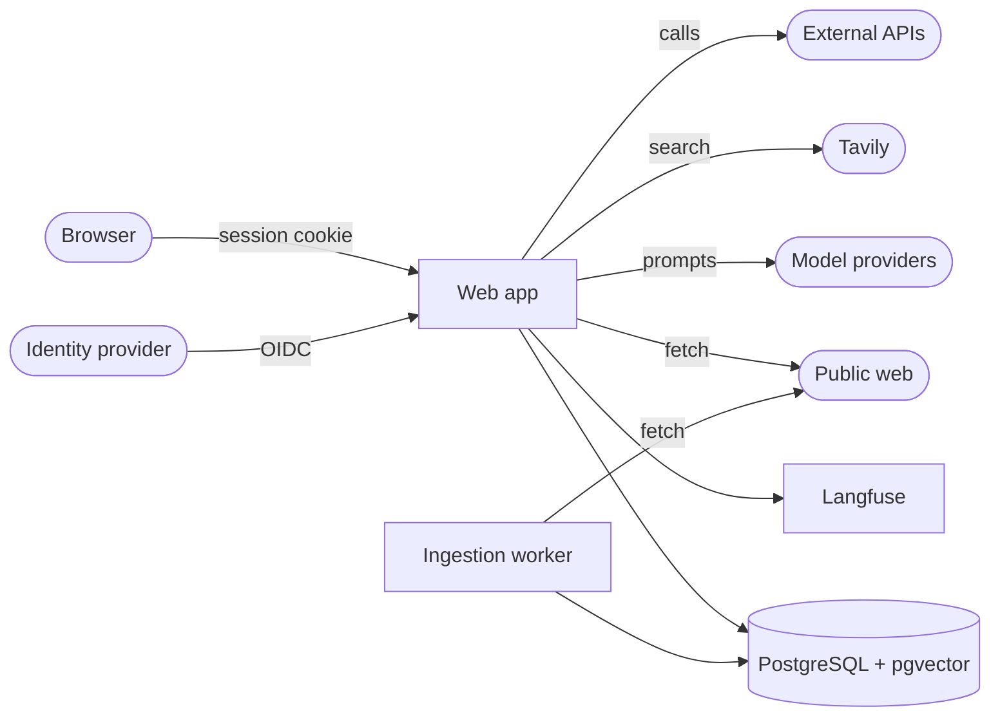

# Security model

What IngenMind protects, from whom, and where each risk is handled. Every gap
names the roadmap issue that closes it (R-numbers, tracker
[#120](https://github.com/cherrydasika/ingenmind/issues/120)). Keep this file
up to date when a change moves a risk. To report a vulnerability, see
[SECURITY.md](../SECURITY.md).

Last reviewed: 2026-10-21 (R02, #81).

## What we protect

| Asset | Where it lives | Why it matters |
|---|---|---|
| The knowledge base | PostgreSQL `rag_chunks`, `research_chunks` | Answers are only as good as what is in it; poisoning it misleads every user |
| People's questions and answers | `sessions` (30 days), Langfuse traces | May contain personal data |
| Flows, versions and the live flow | PostgreSQL `flows*` | Decide how every question is answered, which tools run and which checks apply |
| Users, roles and permissions | PostgreSQL `users` | Who may change the knowledge, flows and settings |
| Secrets | `.env` locally; SSM parameter `/rag-systems/prod/langfuse-env` on EC2 | Model provider keys, OIDC client secret, session secret, Langfuse keys, database passwords |
| Spend | Model providers, Tavily, AWS | Every question costs tokens; research and evaluations cost more |
| The host | EC2 instance, Docker | Reaches the database, Langfuse and the AWS instance role |

## Who we protect it from

- **A signed-in user** with fewer permissions than they want: may try other routes, other people's sessions, or to make the agents do something out of scope.
- **Someone who is not signed in**: today they can only reach the sign-in page (EC2 is private behind SSM; public access is R09, #23).
- **A malicious web page or document**: found by the research agent, picked as a source, or pasted as an ad-hoc document. It may carry hidden instructions (indirect prompt injection) or false facts (poisoning).
- **A compromised or misbehaving tool or provider**: an external API returns hostile content, or a model provider is down.
- **A stolen session cookie or API key** (API keys arrive with R46, #106).
- **A supply-chain compromise**: a Python or npm dependency, a base image, a GitHub Action.

## Trust boundaries

Everything to the right of the web app and worker is outside our control.
Text coming back from models, web pages, tools and documents is **data,
never instructions**, and is checked before it reaches a user or the
knowledge base.

## The OWASP Top 10 for LLM applications (2025)

| # | Risk | Handled today | Gap and the issue that closes it |
|---|---|---|---|
| LLM01 | **Prompt injection** | Input guardrail on every question, fail closed, whatever the flow (`app/guardrails.py`); research guardrail on every researched page; the answer evaluator judges answers only against the evidence. **Since R12** (`app/injection.py`): passages, search results and tool replies are fenced as quoted data; instruction-like passages are withheld from every model (evaluators too) and listed on the Ingestion tab; researched pages like that are never added | Detection is phrase-based: a reworded instruction still reaches the model inside the fence. Since R14, a red-team set (24 questions) runs on every published version and going live below 90% asks first; it's generic, not written from each domain's blueprint |
| LLM02 | **Sensitive information disclosure** | Traces are public-safe (no prompts, drafts or tool inputs reach the browser); sessions are visible to their owner and `view_sessions` only; agent memory learns from outcomes, never from anyone's words. **Since R11** (`app/pii.py`): emails, phones, card numbers, NI numbers, IBANs and IP addresses in questions are masked before any model, tool, session or trace sees them (or refused, per flow); web search queries and everything sent to Langfuse are always masked | Names and addresses aren't detected (a model-based detector could be added). Retention and per-user export/delete: **R59 (#115)** |
| LLM03 | **Supply chain** | Dependencies bounded by major version; images built in CI from the reviewed commit; deploys only from `main` through an OIDC role limited to one SSM document. **Since R04** (`.github/workflows/security.yml`, every PR, main and weekly): pip-audit and npm audit, a Trivy scan of the web image (fixable high and critical fail), gitleaks over the whole history, CodeQL (Python, JavaScript, Actions); every Action pinned by commit SHA; Dependabot for pip, npm, Docker and Actions; the image takes Debian's security updates and drops pip. Triaged packages, each with its reason: `.github/security/allowed.txt` | Pillow < 13 is held back by fastembed (text only; no image is decoded). The web image runs as root: before public access, **R09 (#23)** |
| LLM04 | **Data and model poisoning** | Nothing enters the knowledge base without an admin's approval in setup; every chunk traces to its approval ("Why is this here?"); the source validator scores authority, freshness, consistency and relevance | Research during users' questions still ingests automatically (the user's choice for now); approving researched pages before they are added: **R32 (#100)**. Since R12, researched pages with hidden instructions are never added |
| LLM05 | **Improper output handling** | Model text is escaped before any markup is added (`markdown()` and `richText()` in `web/static/js/ui.js`); links only for `http(s)`; nothing a model writes is run as code or SQL (parameterised queries). **Since R05:** a strict Content Security Policy (scripts only from the app's origin, no framing, no plugins) contains a future escaping bug | — |
| LLM06 | **Excessive agency** | Every tool today is read-only (knowledge-base search, web search, fetch, weather, timetables, entry requirements); an agent only gets the tools plugged into it in the flow; flows are validated and versioned, and only promoting a version changes what users get. **Since R13:** an agent can only call the tools it was offered; API arguments are checked against the schema and for personal data, links and injection; a per-tool budget per question; tools with side effects are refused until approval exists | Approval for side-effecting tools: **R32 (#100)**; then MCP and OpenAPI tools: **R38 (#104)**, **R39 (#105)** |
| LLM07 | **System prompt leakage** | Prompts and drafts stay server-side; the output guardrail refuses answers that reveal instructions | Since R14, the red-team set includes prompt-leak questions on every publish |
| LLM08 | **Vector and embedding weaknesses** | One knowledge base per deployment, so no cross-tenant retrieval; embeddings never leave the server | When there are several collections or workspaces, retrieval must respect who may see what: **R35 (#102)**, **R60 (#116)** |
| LLM09 | **Misinformation** | Every answer is judged for correctness, faithfulness, completeness and citations against its evidence; a failing answer is never shown; "not available" is preferred to a guess; readiness and evaluations before going live | Scheduled evaluations and a regression gate on promotion: **R56 (#114)**. User feedback: **R51 (#111)** |
| LLM10 | **Unbounded consumption** | Agent turn limits, two supervisor rounds, a research budget per question; flow size limits. **Since R06:** questions per minute and tokens per day per user, a global daily cap, 429 with Retry-After (`app/usage_limits.py`) | Research runs are not limited separately, and a single run has no hard token, time and tool-call budget: **R15 (#90)** |

## The web application

| Area | Handled today | Gap |
|---|---|---|
| **Sign-in** | OIDC (Cognito on EC2) with PKCE, state and nonce; invite-only; the app stores no passwords; dev sign-in answers only on localhost and is refused when `RAG_DEPLOYMENT=aws` | — |
| **Authorisation** | Every `/api` route names the permission it needs (`auth.RULES`), checked in middleware; users are deactivated, never deleted | — |
| **Dangerous actions** | Starting over needs a fresh sign-in (`/auth/confirm`, password asked again, valid once for 5 minutes) | — |
| **Session cookie** | Signed, HttpOnly, SameSite=Lax, Secure when `SESSION_COOKIE_SECURE`; at most 12 hours; **since R05** admins are signed out after `ADMIN_IDLE_MINUTES` (60) without using the app | — |
| **Cross-site requests** | **Since R05** (`app/web_security.py`): state-changing requests whose Origin (or Sec-Fetch-Site) shows another site are refused, on top of SameSite=Lax | — |
| **Headers** | **Since R05:** CSP, `X-Content-Type-Options`, `X-Frame-Options`, `Referrer-Policy`, `Permissions-Policy`, `Cross-Origin-Opener-Policy` on every response; HSTS when served over HTTPS | — |
| **Accountability** | Setup records each step with who and when. **Since R07** (`app/audit.py`): every state-changing admin-level request, refused attempts, sign-ins and sign-outs, in an append-only table (a trigger refuses UPDATE, DELETE and TRUNCATE); Admin → Audit log with CSV export | A database superuser can still drop the trigger: ship the log off the host for tamper evidence (with alerts, **R55 (#113)**) |
| **Server-side request forgery** | **Since R02:** the scraper (setup, ingestion, research) fetches only public addresses and checks every redirect; `FETCH_ALLOW_PRIVATE=true` allows private networks for an intranet, never loopback, link-local (cloud metadata) or reserved addresses. On EC2 the metadata service also needs IMDSv2 tokens | DNS rebinding between the check and the connection is not prevented (low risk: the metadata service needs a token, and the database is not HTTP) |

## The deployment

| Area | Handled today | Gap |
|---|---|---|
| **Network** | EC2 has no inbound access; people reach it through SSM port forwarding; the web app binds to 127.0.0.1 | Public access with HTTPS and a WAF: **R09 (#23)** |
| **Secrets** | On EC2 the release's `.env` comes from an SSM parameter; `DEPLOYMENT.local.md` and `.env` are git-ignored; gitleaks checks every PR and the whole history (R04; none found on 2026-10-21) | Langfuse secrets match the local development `.env`: **R03 (#21)** |
| **Deploys** | Only merged `main`, through GitHub OIDC roles that trust only the `production` environment and may run one SSM document | — |
| **Backups** | Data on a separate EBS volume; **since R08** daily snapshots by Data Lifecycle Manager, 14 kept (`infra/terraform/backup.tf`), and `scripts/aws/restore-test.sh` to prove one restores | Applying the policy and the first restore test wait on approval: **R08 (#22)** |
| **Monitoring** | Langfuse traces; per-flow metrics | Alerts on errors, cost and quality; CloudWatch alarms: **R55 (#113)** |

## Reviewing a change

Ask of every pull request that touches these areas:

1. Does text from a model, page, document or tool reach `innerHTML`, a shell, SQL or a URL without escaping or validation?
2. Does a new route name its permission in `auth.RULES`?
3. Does a new tool have side effects? Then it needs R13's approval path.
4. Does anything new fetch a URL? Use the scraper (`common.scraping`), which checks addresses.
5. Does it store personal data? Then it needs a retention period and must be covered by export and delete.
